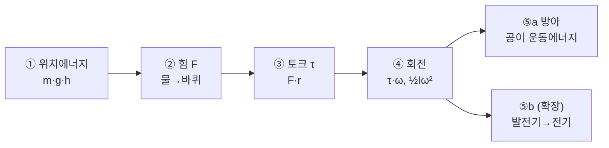

# mulle-bangah (물레방아) — 수력식 디딜방아

**도자기 물레가 아닙니다.** 물레방아는 전통 한국식 **물방아**입니다. 낙수나 흐르는 물이 **나무 물레바퀴**를 돌리고, **축(굴통)**이 **누름 캠(눌림목)**을 구동합니다. 캠은 **방아채**를 움직여 **방앗공이**가 **돌확(방아확)** 안의 곡식을 찧게 합니다.

Sources: [한국민족문화대백과 — 물레방아](https://encykorea.aks.ac.kr/Article/E0019840), [삼척 물레방앗간](http://samcheok.grandculture.net/samcheok/toc/GC06700015), [울산 상수도 — 수력이용](https://water.ulsan.go.kr/water/contents/contents.do?mId=7010400).

---

## 다시 시작하는 이유

`models/pottery-wheel/`은 **탁상형 전동 도자기 물레**를 모델링했습니다. 이는 다른 기계입니다. 이 프로젝트는 **물레**(water wheel)와 **방아**(곡식을 찧는 mill)가 합쳐진 이름을 가진 **전통 수력식 물방아**를 모델링합니다.

---

## 에너지 전달 과정 (설계 기준)

각 Phase에서 이 과정의 한 연결 고리를 CAD / viewer / URDF로 확인할 수 있어야 합니다.



| 단계 | 물리 | 기계 요소 | Phase |
|------|---------|-----------------|-------|
| ① | Gravitational PE: `E = ρ Q g h` (head pond → flume) | 보, 수로, 낙차 | B6 |
| ② | Jet force on buckets / paddles | 물줄기 → 물레바퀴 접촉 | B1 |
| ③ | Torque `τ ≈ m_bucket g r` (overshot imbalance) | 바퀴 반경, 통(bucket) | B1, B7 |
| ④ | Shaft power `P = τ ω` | 굴통 (축) | B2 |
| ⑤a | Cam lift → lever → pestle drop | 눌림목 → 방아채 → 공이 | B3–B5 |
| ⑤b | Optional generator on axle | 터빈/발전기 placeholder | B10 |

**윗걸이와 아랫걸이** (이 프로젝트는 효율이 높지만 낙차가 필요한 **윗걸이 / overshot** 방식을 기본으로 합니다.)

| 유형 | 물 유입 위치 | 주 에너지원 | 일반적인 낙차 |
|------|-------------|-------------------|--------------|
| 윗걸이 | Top of wheel (flume) | Gravity in filling buckets | ≥ ~1.5 m |
| 아랫걸이 | Bottom stream | Flow kinetic energy | Low head, fast stream |

---

## Machine anatomy

```
        [수로 flume] ──water──►  ╭──╮
                               │  │  물레바퀴 (water wheel)
                               ╰┬─╯
                    굴통 axle ──┼── 눌림목 (cam) ──► 방아채 (lever)
                                │                      │
                                │                   공이 (pestle)
                                │                      ▼
                           (쌍방아: 축 양쪽 각 1조)  방아확 (mortar)
```

**쌍방아 (양방아):** 물레바퀴 하나와 축의 캠 두 개, 방아채 두 개를 사용해 방앗공이가 번갈아 움직입니다(마차를 끄는 말 두 마리처럼). Phase B8에서 쌍방아 배치를 구현합니다.

---

## Layout

```
models/mulle-bangah/
  README.md                 ← 이 계획 문서
  src/
    lib/
      dims.py               ← B7 knobs (h, Q, wheel OD, cam radius…)
      energy.py             ← B7: τ, P, stroke rate from dims (no FEA)
    water_wheel.py          ← B0–B1
    axle.py                 ← B2
    press_cam.py            ← B3
    mill_arm.py             ← B4
    mortar.py               ← B5
    flume.py                ← B6
    mill_frame.py           ← B7 (structure)
    assembly.py             ← B8
  STEP/
  URDF/                     ← B9: wheel revolute + cam-driven pestle
  bench/                    ← timing / live-reload notes
```

---

## 단계

| Phase | 구현 항목 | 결과 | 검증 |
|-------|--------|----------|-----------|
| **P0** | scaffold | ✅ |
| **B0** | `water_wheel` disc | ✅ (see `_wheel_blank`) |
| **B1** | buckets + 십자목 | ✅ |
| **B2** | `axle` | ✅ |
| **B3** | `press_cam` | ✅ |
| **B4** | `mill_arm` | ✅ |
| **B5** | `mortar` | ✅ |
| **B8** | partial `assembly` | ✅ (5 parts, kinematic loop) |
| B6 | `flume` | — |
| B7 | `mill_frame` + energy | — |
| B9 | URDF | — |

### 권장 순서

```
P0 → B0 → B1 → B2 → B3 → B4 → B5 → B8 (minimal loop) → B6 → B7 → B9 → B10
```

건축 요소(flume, 방앗간)보다 **운동학적 연결**(물레 → 캠 → 방앗공이)을 먼저 구현합니다.

---

## 좌표 계약 (초안)

| 기준점 | 좌표계 |
|-------|--------|
| Wheel center | origin; axle along **+X** |
| Wheel plane | **YZ**; water falls **+Z** onto top rim |
| Ground / 방앗간 floor | **Z = 0** |
| Wheel axis height | **Z = WHEEL_OD/2** below flume lip (overshot) |
| Mill fulcrum | **−X** side of house; pestle over mortar **Z=0** |

B8 assembly가 처음 정상 검증되면 mate를 구체화합니다.

---

## 기본 크기 (민속 자료 / 문헌 기준)

| 매개변수 | 값 | 비고 |
|-----------|-------|------|
| `WHEEL_OD` | 2200 mm | 삼척·해석 문헌 관례 |
| `WHEEL_THICK` | 400 mm | |
| `AXLE_D` | 60 mm | steel pipe |
| `HEAD_HEIGHT` | 3000 mm | tunable — drives energy estimate |
| `MILL_ARM_LEN` | 2800 mm | lever to pestle |

전체 목록: `src/lib/dims.py`.

---

## 빌드 명령

```bash
npm run agents:python:setup
npm run agents:python -- models/mulle-bangah/src/assembly.py
npm run agents:cad:assembly-validate -- mulle-bangah   # validate + interfere + layout contract
```

Assembly 계약: `bench/assembly-contract.md`
검증 skill: `$cad-assembly-validate`

---

## 다른 폴더와의 관계

| 폴더 | 설명 |
|--------|------------|
| `models/bench-pottery-wheel/` | Workspace **pipeline** benchmark (misnamed part geometry) |
| `models/pottery-wheel/` | Electric pottery wheel product attempt (wrong domain) |
| **`models/mulle-bangah/`** | **This** — traditional water mill |

bench의 **cadgen 패턴**(AssemblyHelper, `drive_layout` 방식의 datum)은 재사용하되, pottery-wheel 부품은 재사용하지 않습니다.

---

## 범위 제외 (v1)

- CFD, fluid volume mesh, actual water simulation
- Structural FEA of timber frame
- Exact wooden joinery (나무못, mortise)
- Historical reconstruction of a specific registered heritage site

---

## 다음 단계

1. Workspace에서 `models/mulle-bangah/STEP/assembly.step`을 열어 wheel, cam, arm, mortar의 정렬을 확인합니다.
2. **B6** (flume), **B7** (mill frame + 에너지 출력)을 진행합니다.
3. **B8+**에서 두 번째 방아채(쌍방아)를 추가한 뒤 **B9** URDF를 진행합니다.
