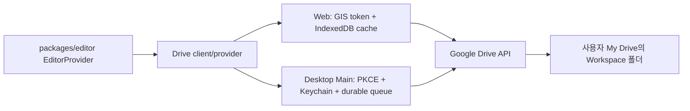

# Google Drive 직접 동기화 설계 조사

조사 기준일: 2026-11-15

## 결정 요약

Google Drive를 PKMS 파일의 canonical storage로 쓰는 것은 가능하다. 사용자 한 명과 몇 대의 기기라면 Cloudflare Worker의 파일 API, Supabase 문서 저장, GitHub repository mirror를 동기화 경로에서 제거할 수 있다. 다만 기존 backend를 Drive SDK로 바꾸는 정도의 작업은 아니다. 현재 sync의 revision guard, Yjs 실시간 세션, operation idempotency, durable local queue를 대체하거나 제품 요구에서 제외해야 한다.

이 조사는 이전 prototype 결정 이력이다. 현재 결정은 **모든 editing client가 Google Drive API에 직접 연결하고, PKMS Worker·PKMS Server·Supabase·GitHub를 file sync data path에서 제거**하는 것이다. 사용자가 선택했으며 목표와 acceptance contract는 [Google Drive 직접 동기화 스펙](../../../../pkms/google-drive-direct-sync.md)을 따른다. 격리 root와 migration parity가 확인될 때까지 기존 PKMS data는 변경하지 않는다. Backend 제거는 Web hosting/정적 파일 제공, MCP 등 sync 이외의 기능이 자동으로 제거된다는 뜻이 아니다.

이 결정은 Web의 background guarantee를 낮춘다. Web은 열린 탭에서 Drive API를 polling하고 token 만료 후 사용자가 재인증해야 한다. Desktop/iOS는 OS credential store에 native refresh token을 두되, iOS background 실행은 OS가 허용하는 opportunistic work만 약속한다. 모든 플랫폼의 무인·상시 동기화가 필요하면 backend-free 조건과 양립하지 않는다.

100 GB Google Drive 구독은 파일 저장 용량을 제공한다. Drive API quota, OAuth 권한, 앱 검증을 자동으로 해결하지는 않는다. API의 현재 문서화된 quota는 분당 quota unit 중심이며, 2026년 API 프로젝트 생성 시 적용되는 한도와 무료 사용 범위가 이전 Worker의 일일 요청 한도와 다르다. [Drive API usage limits](https://developers.google.com/workspace/drive/api/guides/limits)

## 현재 구조와 모듈 경계

- 공용 Editor UI는 [packages/editor](../../../../../../packages/editor/README.md)의 `EditorProvider`를 사용한다. UI를 유지하고 Drive 파일·폴더 작업을 새 provider로 연결할 수 있는 적절한 경계다.
- [createPkmsEditorProvider](../../../../../../packages/pkms-client/src/features/editor/pkmsEditorProvider.ts)는 tree/document를 provider 형태로 감싸지만, open session과 search는 아직 PKMS API/Yjs에 의존한다.
- [pkms-client API](../../../../../../packages/pkms-client/src/client/api.ts)와 [useDocumentSync](../../../../../../packages/pkms-client/src/features/editor/useDocumentSync.ts)는 `/api/workspaces/...` route에 직접 요청한다. 저장은 Yjs update 후 PKMS server에 보내고, GitHub flush 상태를 읽는다.
- [Desktop syncBridge](../../../../../../apps/workspace-app/src/main/pkms/syncBridge.ts)는 PKMS snapshot/change feed, revision cursor, Yjs update, pending operation, Supabase Realtime을 직접 사용한다. 따라서 `EditorProvider`만 바꾸면 Desktop folder sync가 Drive로 이동하지 않는다.
- PKMS Server는 GitHub OAuth·repo, Supabase vault/revision/realtime, R2 asset뿐 아니라 MCP, Home token 등 다른 기능도 함께 제공한다. Drive 전환 뒤에도 남는 기능이 있는지 분리 수용 계획을 세워야 한다. 관련 경계는 [PKMS Server 문서](../../../../pkms/server/README.md)에 있다.

**판정:** Editor와 tree UI 재사용은 쉽다. 데이터/auth/sync provider의 교체는 별도 작업이다. 저장소 추상화가 이미 끝나서 단순 이식이면 되는 상태는 아니다.

## Drive 직접 연결로 얻는 결과

- Markdown, asset, folder를 사용자 My Drive의 일반 폴더에 저장한다. 파일은 Drive 웹 UI와 Finder에서 사용자가 확인할 수 있다.
- Google Drive API의 file ID를 안정적 item ID로 사용한다. 폴더 경로는 parent ID와 이름으로 계산하고, rename/move는 path 문자열 대신 ID를 갱신한다.
- `changes.getStartPageToken`과 `changes.list`를 각 기기별 durable cursor로 사용한다. 마지막 page에 도달한 뒤에만 `newStartPageToken`을 저장한다. `changes.list`의 change는 변경 내용 그 자체가 아니므로 필요한 file metadata/content를 다시 읽는다. [Retrieve changes](https://developers.google.com/workspace/drive/api/guides/manage-changes)
- 변경 알림은 wake-up 용도로만 쓴다. Google `changes.watch`는 HTTPS webhook으로 알림을 보내고 채널이 만료되므로, server를 없애는 구성에서는 사용할 수 없다. Desktop은 poll하고, Web은 탭이 열린 동안 poll해야 한다. [Drive push notifications](https://developers.google.com/workspace/drive/api/guides/push)
- Drive API는 resumable upload와 binary file revision을 지원한다. 하지만 Drive revision history는 PKMS의 revisioned compare-and-swap/CRDT와 동일한 동기화 계약이 아니다. 일반 binary revision은 보통 30일 뒤 삭제 가능하며, 새 revision이 누적되면 더 빨리 정리될 수 있다. `Keep forever`는 파일당 최대 200개이고 storage를 차지한다. 충돌 복사본을 직접 생성해 내용을 보존해야 한다. [Manage revisions](https://developers.google.com/workspace/drive/api/guides/manage-revisions)

## OAuth와 권한

### 저장소 scope

새 Drive 폴더와 그 안의 모든 하위 항목을 앱이 생성하는 모델을 우선한다. 그러면 광범위한 `drive` scope 대신 `drive.file`을 검토할 수 있다. 이 scope는 앱이 생성했거나 사용자가 앱에 명시적으로 열어 준 Drive 파일에 한정된다. `drive`는 전체 사용자 Drive를 읽고 쓸 수 있는 restricted scope이며 공개 앱 검증이 필요하다. Restricted scope 데이터를 server에 저장/전송하면 추가 security assessment 대상이 될 수 있다. [Choose Drive API scopes](https://developers.google.com/workspace/drive/api/guides/api-specific-auth)

기존 Drive 임의 폴더를 통째로 열고 앱 밖에서 추가된 파일도 자동 탐색하는 요구는 `drive.file`만으로 충족된다고 가정하지 않는다. 대상 폴더 선택과 그 하위 항목 접근을 최소 권한으로 허용하는지 실제 OAuth prototype으로 증명해야 한다. 실패하면 새 앱 전용 폴더로 import하거나 restricted `drive` scope 검증을 받아야 한다.

`appDataFolder`는 사용자에게 보이지 않고 다른 Drive 앱과 공유할 수 없다. 따라서 Markdown 본문이나 사용자가 보는 tree를 넣지 않는다. 필요하다면 소규모 앱 설정만 저장한다. [Store application-specific data](https://developers.google.com/workspace/drive/api/guides/appdata)

### Desktop과 Web 세션 차이

- Desktop은 시스템 browser OAuth authorization code + PKCE를 사용한다. 장기 refresh token은 macOS Keychain 등 OS secure storage에 둔다. Client secret을 Electron 앱에 비밀로 넣을 수는 없다. [OAuth for desktop apps](https://developers.google.com/identity/protocols/oauth2/native-app)
- Web이 backend 없이 Drive를 직접 호출하면 Google Identity Services token model의 짧은 access token을 사용한다. 만료 뒤 새 token은 사용자 gesture로 요청해야 한다. 장시간/사용자 부재 중 refresh가 필요한 authorization code flow는 endpoint와 refresh token을 관리할 backend가 필요하다. [Web authorization model](https://developers.google.com/identity/oauth2/web/guides/choose-authorization-model), [GIS token model](https://developers.google.com/identity/oauth2/web/guides/use-token-model)
- Access token 수명은 고정 상수로 가정하지 않는다. OAuth token response의 `expires_in`이 발급된 token의 남은 초를 제공하며, Google의 Desktop OAuth 공식 예시에는 `3920`초(65분 20초)가 있다. 구현은 응답의 `expires_in`으로 만료 시각을 계산하고 실제 값을 기록해야 한다. [Desktop OAuth token response](https://developers.google.com/identity/protocols/oauth2/native-app)
- GIS browser token model은 access token만 발급하며, refresh token을 주지 않는다. 만료 후 `requestAccessToken()`을 사용자 조작으로 다시 실행해야 한다. access token을 장기 저장하지 않는다. [GIS token model](https://developers.google.com/identity/oauth2/web/guides/use-token-model)
- Desktop refresh token은 통상 사용자 revoke 전까지 재발급에 쓰지만 영구 보장은 아니다. 사용자가 접근을 revoke하거나, 6개월 미사용 등 Google의 만료 규칙이 적용되거나, 테스트 consent가 만료되면 다시 로그인해야 한다. [OAuth refresh token lifecycle](https://developers.google.com/identity/protocols/oauth2)
- OAuth consent screen이 External/Testing이면 Drive scope를 포함한 grant/refresh token은 7일 후 만료된다. 실사용 Desktop의 무인 background sync 전에 publishing/verification 상태를 해결해야 한다. [OAuth refresh token expiration](https://developers.google.com/identity/protocols/oauth2)
- Browser token은 localStorage에 저장하지 않는다. Web은 현재 탭 메모리에서 token과 `expires_in` countdown만 관리하고, 만료 후 재인증 button을 제공한다. Desktop refresh token은 OS credential store에 둔다.

## 데이터 및 충돌 정책 초안

| 대상 | Drive 표현 | 적용 규칙 |
|---|---|---|
| Workspace root | My Drive 안의 앱 관리 폴더 | root Drive file ID를 설정에 저장하고, 연결 시 동일 폴더임을 확인한다. |
| Folder | MIME type `application/vnd.google-apps.folder` | parent ID 기반으로 계층을 구성한다. 빈 폴더도 marker로 보존한다. |
| Markdown/asset | Drive binary file | `fileId`가 identity, `parents`와 `name`이 위치다. bytes hash는 로컬 검증에 사용한다. |
| Delete | Drive trash/delete + change feed tombstone | 삭제 의도와 base를 local durable queue에 먼저 기록한다. 애매한 missing/permission loss는 삭제로 간주하지 않는다. |
| Concurrent edit | 별도 Drive revision + conflict copy | 변경 전에 본 remote metadata/content와 다르면 overwrite하지 않는다. 양쪽 내용을 별도 path로 보존하고 사용자에게 attention을 표시한다. |
| Search | device-local content index | Drive metadata search만으로 현재 PKMS의 줄·문맥 검색을 대체하지 않는다. 검색에 필요한 Markdown을 local cache/index에 내려받고 changes feed로 갱신한다. |

Drive API가 노출하는 `headRevisionId`는 blob file의 revision 식별자이며, 문서용 Yjs revision이나 PKMS operation base와 같은 비교 계약으로 취급하지 않는다. 앱 차원의 “읽은 revision과 같은 경우에만 쓰기”가 실제 API에서 원자적으로 보장되는지는 prototype으로 확인한다. 원자적 조건부 write가 없다면 같은 파일을 동시에 수정하는 상황을 완전한 last-write-wins로 처리하지 않는다. 사용자 단독 사용이라도 두 기기가 같은 파일을 편집할 수 있으므로 conflict-copy acceptance가 필수다.

## 100 GB와 API 운영량

- Storage quota와 API quota는 서로 다른 한도다. 100 GB는 Drive가 저장할 수 있는 전체 용량이고, API 요청 수나 분당 처리 quota를 늘리는 설정이 아니다.
- Drive API 문서는 list/change 요청에 quota unit 비용을 적용한다. 현재 문서상 분당 project/user quota는 각각 1,000,000/325,000 units이고, 1 TB/day egress threshold와 400,000,000 quota units/day의 billing threshold가 있다. 2026-05-01 이후 신규 API project에 적용되는 값이며 그 이전에 사용된 project는 기존 값일 수 있다. Cloud Console에서 실제 project 한도를 확인해야 한다. 표준 API 사용은 현재 추가 비용 없이 제공되지만, 초과 사용 과금 안내는 2026년 중 별도 공지 예정이라고 문서화돼 있다. [Drive API limits and pricing status](https://developers.google.com/workspace/drive/api/guides/limits)
- 5초마다 change feed 한 번씩 읽는다면 한 기기에서 분당 12회의 list 요청이다. 문서상 `changes.list`는 100 quota units/request이므로 약 1,200 units/minute다. 즉 무한 재시도는 여전히 방지해야 하지만 현재 Worker Free의 100k/day request cap과 같은 수치/운영 모델은 아니다.
- 5,733개 파일의 최초 content download는 API 호출 수보다 총 bytes, 첫 tree 구축 지연, offline 재시작 시간에 영향을 준다. 초기 sync 후에는 change feed와 변경 파일만 내려받고, 주기적 full scan은 복구 용도로 제한한다.
- HTTP 429와 quota 관련 403은 truncated exponential backoff + jitter 후 재시도한다. 한 요청 실패가 모든 file sync를 막지 않게 path별 pending 상태를 유지한다. [Drive API error handling](https://developers.google.com/workspace/drive/api/guides/handle-errors)

## 격리 prototype

`apps/pkms-web/prototypes/google-drive-direct/`는 production route나 기존 PKMS 데이터를 사용하지 않는 static browser prototype을 둔다. Google Identity Services의 public Web client ID를 사용하고, Browser가 Drive API v3를 직접 호출한다. access token은 memory only다. prototype은 API response의 `expires_in`을 화면에 초 단위로 표시하고 만료 후에는 사용자 button으로만 다시 받는다.

Google OAuth client 설정은 [Google Cloud OAuth clients](https://console.cloud.google.com/auth/clients)에서 한다. Cloud project에서 Drive API를 enable하고 OAuth consent audience를 External/Testing으로 지정한 다음, OAuth client type을 Web application으로 생성한다. Authorized JavaScript origin은 prototype의 실제 localhost origin(`http://localhost:4173`)이고, GIS token model에는 redirect URI를 설정하지 않는다. Data Access scope는 `https://www.googleapis.com/auth/drive.file`만 요청한다. Testing audience에서는 계정을 Test users에 추가하고, 7일짜리 testing grant 경계를 확인한다. [Google: Get a client ID](https://developers.google.com/identity/oauth2/web/guides/get-google-api-clientid), [Drive API JavaScript quickstart](https://developers.google.com/workspace/drive/api/quickstart/js)

Client ID는 public identifier이므로 prototype 화면에 입력할 수 있고, client secret은 사용하지 않는다. prototype이 실제 Drive에 만드는 item은 `Workspace Drive Prototype` 폴더 아래에만 둔다. 기존 PKMS root는 선택하거나 수정하지 않는다.

### Prototype live OAuth 확인

2026-11-15 로컬 Chrome과 Google Cloud Console project `workspace-514715`에서 설정과 실제 왕복을 검증했다. OAuth client `workspace-web`의 `http://localhost:4173` Authorized JavaScript origin으로 GIS popup과 동의 절차가 완료됐고, GIS token model에 필요한 redirect URI는 설정하지 않았다. Audience는 External / Testing이며 현재 로그인 계정을 Test users에 등록했다. Data Access에는 `https://www.googleapis.com/auth/drive.file`만 선언했다. Google Drive API는 `사용 설정됨`이다. Google 경고 화면을 통과하고 사용자가 동의를 승인한 뒤 scope가 포함된 access token을 받았다.

GIS 응답의 실제 `expires_in`은 **3599초**였다. prototype 화면의 countdown은 해당 응답으로부터 감소했고, token은 탭 메모리에만 유지됐다. 만료 뒤 사용자 재인증은 만료를 기다려 확인하지 않았다. 두 번째 같은-origin 브라우저 탭에서 별도 OAuth token을 발급해 두 client의 동시 편집을 재현했다.

실제 Google Drive에서 다음을 확인했다.

- 격리된 `Workspace Drive Prototype` 폴더와 `integration-check` 하위 폴더 생성
- Markdown 생성, 다운로드/읽기, 수정 저장 후 Drive metadata 및 checksum 재조회
- 하위 폴더 진입, `changes.getStartPageToken` 초기화, 이후 변경 한 건을 `changes.list`로 조회하고 최종 cursor 반영
- 하위 파일 rename 후 목록에서 새 이름 확인, rename된 파일의 baseline으로 바로 저장해 새 checksum 재조회. 이 실제 흐름에서 발견한 rename 후 baseline 누락을 수정하고 재검증했다.
- 두 client 중 한쪽이 원본을 수정한 뒤 다른 쪽이 오래된 base로 저장을 시도할 때 원본 overwrite를 막고 conflict copy 생성
- 원본 파일을 다시 Drive API로 열어 두 번째 client의 `Second client edit: remote version.` 본문과 checksum `0c30ebf7133d055ab86ffbbef7608e0d` 확인. conflict copy도 별도로 열어 첫 client의 `First client stale edit: preserve both versions.` 내용 확인
- 생성한 원본 Markdown을 Drive 웹 UI에서 직접 열어 내용 확인

이 검증은 `drive.file`로 prototype가 만든 격리 파일에 대한 접근과 저장을 입증한다. 사용자가 임의로 기존 Drive 폴더를 선택하거나 앱 밖에서 추가된 항목까지 발견할 수 있다는 뜻은 아니다. 페이지 reload 뒤 사용자가 다시 연결해 새 token을 받고 기존 테스트 root를 이어서 열 수 있었지만, 실제 token 만료 시점까지 기다리는 검증은 하지 않았다. Drive `files.update` 사전 metadata 확인과 media upload는 하나의 원자적 compare-and-swap으로 확인되지 않았으므로 두 동시 쓰기 사이의 race는 별도 해결 대상이다. offline queue, Desktop PKCE/Keychain, move/trash, 기존 tree import는 이번 live acceptance 범위에서 검증하지 않았다.

### 프로젝트 적용 판정

판정은 **Drive API 직접 연결을 구현 후보로 채택하되, production sync 교체는 보류**다. Browser OAuth와 app-created file CRUD/change feed/conflict-copy path가 실제 Drive에서 동작해 기술적 적용 가능성은 확인했다. 그러나 prototype은 기존 PKMS editor와 전혀 연결하지 않았다. 공용 `EditorProvider`는 UI 경계를 재사용할 여지를 주지만, 현재 provider는 document session을 Yjs와 server route에 연결하고 Desktop sync는 별도 bridge가 durable queue, revision/cursor와 realtime을 관리한다. 실제 전환에는 Drive provider와 local durable cache/queue, desktop OAuth, migration/recovery 기능이 필요하다. 특히 Drive API의 preflight와 upload 사이 race를 막는 조건부 쓰기 계약은 이 실험으로 입증되지 않았다. 전체 폴더 import 및 hash 비교, offline/restart, token lifecycle, quota retry와 동시 쓰기 acceptance 이후에만 production 전환을 결정한다.

## 권장 목표 구조

- `packages/editor`는 그대로 두고, Drive item/session/search/mutation을 제공하는 adapter를 둔다.
- Google API REST, MIME/path mapping, change-feed paging, upload/download, retry policy는 재사용 가능한 Drive client module 하나가 소유한다.
- Desktop Main은 access token 갱신, secure credential, local filesystem scan/write, crash-safe queue를 소유한다. renderer에는 refresh token을 보내지 않는다.
- Web은 Google API와 직접 통신하고 IndexedDB에 metadata/body/index를 cache한다. Web 탭을 닫았을 때 background sync를 약속하지 않는다. 다시 열면 cursor부터 catch-up한다.
- 같은 Google OAuth Cloud project 아래 Web/Desktop OAuth client를 나누되, scope는 app-owned folder workflow에서 `drive.file`로 제한한다.
- Yjs WebSocket collaboration과 server GitHub flush는 기본 대상에서 제외한다. 한 기기만 편집한다는 계약이 아니라면 conflict-copy/multi-device behavior를 먼저 구현한다.
- PKMS Web frontend hosting, Workspace Home, MCP, PKMS authentication은 file sync와 별도 migration 항목이다. Drive를 canonical storage로 바꾼다고 기존 Worker/Server process 전체가 자동 제거되지는 않는다. Web UI를 계속 제공하려면 정적 frontend hosting은 별도로 필요하다.

## 대안 평가

| 선택지 | 장점 | 제약 | 판단 |
|---|---|---|---|
| Drive API를 각 client에서 직접 호출 | 별도 파일 backend가 없고 Google Drive에서 데이터를 확인할 수 있다. 현재 EditorProvider를 재사용한다. | Web refresh-token/background 한계, 직접 auth, conflict/cursor/queue 구현 필요. | 권장 prototype 대상 |
| Google Drive for desktop의 mirror 폴더를 Desktop Editor가 사용 | Desktop은 Drive API auth·sync 엔진을 직접 구현하지 않아도 local files에 접근한다. | Drive client와 Workspace가 두 개의 sync owner가 되기 쉽다. Web API와의 conflict, macOS File Provider placeholder/다운로드 시점 문제를 수락해야 한다. | 비교 fixture로만 검토; production 기본안으로 선택하지 않음 |
| 기존 Worker/PKMS Server 유지 | 현재 Yjs/revision/auth/queue를 활용한다. | 지금의 Cloud request/운영 비용 문제를 유지한다. | 사용자 목표에 맞지 않음 |

Google Drive for desktop은 macOS 12.1+ stream mode에서 Apple File Provider를 사용하며 mirror/stream 차이가 있다. 앱이 관리하는 watcher·queue와 동시에 sync engine으로 쓰면 파일의 로컬 materialization/수정 순서가 두 시스템에 나뉠 수 있다. [Drive for desktop on macOS](https://support.google.com/drive/answer/12178485)

## 단계별 조사·전환 게이트

1. **OAuth/API prototype:** app-owned test folder를 만들고 `drive.file`만 승인한다. Web에서 folder tree/list/create/rename/move/delete/upload/download, Desktop에서 PKCE/Keychain refresh, `changes.list` paging/cursor, 401/403/429 handling을 검증한다. 대상 folder의 하위 app-created item 접근도 명시적으로 증명한다.
2. **Durability/concurrency prototype:** 두 client에서 동일 파일 수정, upload 응답 유실, delete-vs-edit, rename 충돌, 앱 종료 각 경계를 재현한다. 두 내용 모두 보존되고 retry 뒤 중복 file이 생기지 않는지 확인한다. 조건부 write API semantics를 확정한다.
3. **Scale/recovery:** 5,733개 수준의 tree와 현재 asset volume을 test Drive folder에 복제한다. 첫 open latency, full download bytes, incremental poll quota, offline 기간 후 catch-up, content index 준비 시간을 측정한다.
4. **Non-destructive migration dry run:** PKMS source를 읽기 전용으로 snapshot하고 새 Drive root에 복제한다. file path set, empty folders, SHA-256, attachment bytes를 재귀 비교한다. 두 경로의 수량/hash가 일치하기 전까지 새 Drive root를 production editor에 연결하지 않는다.
5. **Cutover:** maintenance window에 새 쓰기를 잠시 멈추고 final delta를 반영한 뒤, Drive root를 canonical로 지정한다. 기존 PKMS Cloud/GitHub는 검증 완료 전까지 read-only rollback source로 둔다. data path에서 제거된 서비스와 Home/MCP/frontend에 남은 의존을 별도 확인한다.

### 완료 기준

- Worker/PKMS Server/GitHub 데이터 경로 없이 Web과 Desktop이 같은 Drive file ID/content로 수렴한다.
- Web은 token 만료와 offline 후 복구 가능한 UX를 제공하고, backend 없는 상태에서 탭 종료 중 sync된다고 잘못 표시하지 않는다.
- change feed pagination, cursor commit, root rename/move/delete, empty folder, assets, retry/lost ACK, 429, auth revoke, app restart에서 데이터 손실/조용한 overwrite가 없다.
- 파일 단위 동시 수정에서 두 버전이 복구 가능하고 conflict를 사용자가 검토할 수 있다.
- 전체 file path set, folder path set, byte length/hash가 source snapshot과 일치한다.
- OAuth app publishing/verification과 실제 Google Cloud project quota/cost 상태가 준비돼 있다.

## 출처

- Google Drive API: [Choose scopes](https://developers.google.com/workspace/drive/api/guides/api-specific-auth), [Changes](https://developers.google.com/workspace/drive/api/guides/manage-changes), [Push notifications](https://developers.google.com/workspace/drive/api/guides/push), [Limits](https://developers.google.com/workspace/drive/api/guides/limits), [Handle errors](https://developers.google.com/workspace/drive/api/guides/handle-errors), [Manage revisions](https://developers.google.com/workspace/drive/api/guides/manage-revisions)
- Google Identity: [Desktop OAuth](https://developers.google.com/identity/protocols/oauth2/native-app), [Web authorization model](https://developers.google.com/identity/oauth2/web/guides/choose-authorization-model), [Token model](https://developers.google.com/identity/oauth2/web/guides/use-token-model), [OAuth token lifecycle](https://developers.google.com/identity/protocols/oauth2)
- Google Drive Help: [Drive for desktop on macOS](https://support.google.com/drive/answer/12178485)
