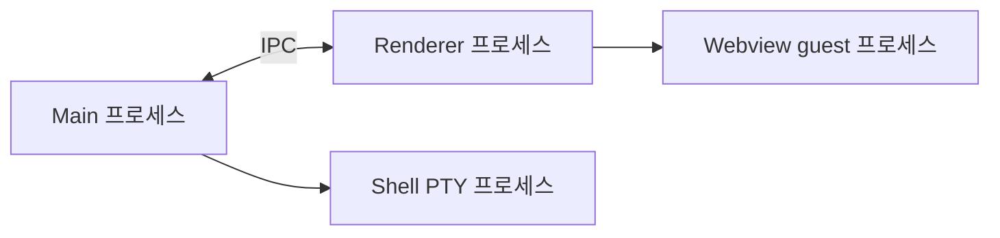
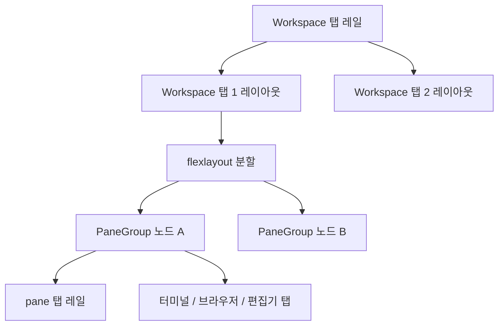

# 전체 구조

Workspace는 터미널, 브라우저, 편집기를 여러 탭과 분할 pane으로 함께 사용하는 Electron 데스크톱 앱입니다.

## 프로세스 구성



| 프로세스 | 역할 |
|---------|------|
| **Main** | 창 관리, Workspace JSON 저장, PTY 생성·크기 조정, 파일시스템 IPC, 클립보드 |
| **Renderer** | React UI, flexlayout, xterm.js, `<webview>` 태그 |
| **Guest** | 활성 `<webview>`마다 실행되는 Chromium renderer. 창마다 여러 개일 수 있음 |
| **PTY** | 터미널 ID마다 실행되는 사용자 셸(bash/zsh) |

Renderer가 직접 셸을 실행하지 않습니다. 모든 PTY 입출력은 `pty:*` IPC를 통해 Main을 거칩니다.

## 두 단계의 탭 구조



1. **Workspace 탭** — 상단 레일의 항목입니다. 각 탭은 별도의 `root_path`와 flexlayout JSON을 가집니다.
2. **flexlayout 탭 노드** — 분할 그리드 안의 pane입니다. 컴포넌트 형식은 `tabgroup`(`PaneGroup`)입니다.
3. **Pane 탭** — pane 안에서 전환하는 터미널, 브라우저, 코드, Markdown 탭입니다.

## 표시 상태 보존

Workspace 탭과 pane 탭은 모두 **마운트 상태를 유지하고 CSS로 숨깁니다.**

| 수준 | 숨김 처리 | embed에서 `display: none`을 피하는 이유 |
|------|-----------|----------------------------------------|
| Workspace 탭 | `visibility: hidden`, `pointer-events: none`, z-index | Workspace host에 `display: none`을 적용하지 않습니다. webview는 pane 수준에서 `visibility: hidden` 처리합니다. |
| Pane 탭 | 콘텐츠 항목에 `visibility: hidden`, `pointer-events: none` | 상위 요소가 `display: none`이면 Chromium guest가 빈 화면이 되거나 멈출 수 있습니다. |

Electron guest가 상위 요소의 `pointer-events`를 항상 따르지는 않으므로 `InteractionCoordinator`가 webview 상태도 적용합니다.

## 상태 소유권

| 상태 | 소유자 | 동기화 |
|------|--------|--------|
| Workspace 탭, 활성 탭, 레이아웃 | Main `Workspace`와 `workspace.json` | `workspace:updated`로 전달 |
| Workspace 탭별 flexlayout `Model` | Renderer `App.tsx`의 `modelsRef` | debounce 후 Main에 저장 |
| pane 그룹 안의 활성 탭 | Renderer `PaneGroup`의 `localActiveId` | model에 비동기 반영 |
| 터미널 스크롤백·출력 | Main `PtyReplayBuffer` | Renderer가 `pty:connect`로 다시 연결 |
| 브라우저 URL·확대율 | 탭 항목의 flexlayout `PaneGroupConfig` | 레이아웃 JSON에 저장 |
| overlay·포인터·portal | Renderer의 `InteractionCoordinator` | 모듈 singleton |

구현 상태는 [기능 상태](../planning/feature-status.md)에서 확인하세요.

## 빌드와 실행

```bash
npm install                 # repository root; installs shared client packages and Workspace dependencies
cd apps/workspace-app
npm run dev    # 개발 실행
npm run build  # apps/workspace-app/out/에 제품 번들 생성
```

타입 검사는 `npm run typecheck`로 Node와 웹 TypeScript 프로젝트를 확인합니다.

## 관련 문서

- [프로세스와 IPC](./02-process-and-ipc.md)
- [Workspace와 레이아웃](./03-workspace-and-layout.md)
- [상호작용 조정기](./04-interaction-coordinator.md)
- [PKMS pane 및 서비스 경계](./07-pkms-integration.md)
