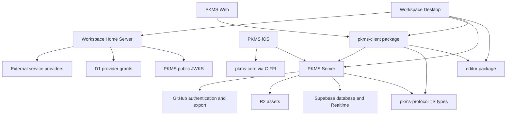

# 전체 시스템 context

Global scope 문서다. [제품과 여정](../product/README.md)을 실행 앱·공유 패키지·외부 저장소의 경계에 대응시킨다. 앱 내부 상태와 알고리즘은 소유 앱 문서에 둔다.

## 실행 가능한 앱

| 앱                                                             | 역할                                                          | 호출/의존 경계                                                              |
| -------------------------------------------------------------- | ------------------------------------------------------------- | --------------------------------------------------------------------------- |
| [Workspace Desktop](../../apps/workspace-app/README.md)        | Electron shell, 로컬 PTY·파일·browser·viewer, Home, PKMS pane | Main이 OS 권한과 native token을 보유. UI는 editor/pkms-client 소비          |
| [PKMS Web](../../apps/pkms-web/README.md)                      | React Router UI·SSR·assets·service proxy                      | PKMS API Worker의 내부 요청으로 UI 제공, 직접 origin은 canonical로 redirect |
| [PKMS Server](../../apps/pkms-server/README.md)                | 로그인·workspace/vault·협업·첨부 파일·MCP·GitHub export       | Web/Desktop/iOS 공통 API, Supabase/R2/GitHub 연결                           |
| [PKMS iOS](../../apps/pkms-ios/README.md)                      | SwiftUI 앱·native document·Keychain session                   | PKMS API/Realtime, Rust Core의 C FFI                                        |
| [Workspace Home Server](../../apps/workspace-server/README.md) | Home provider API·OAuth·grants 저장                           | PKMS JWKS 검증, 전용 D1과 provider 자격 증명                                |

## 의존 방향

앱은 패키지를 소비하고 공유 패키지는 앱 구현을 import하지 않는다. `pkms-core`는 transport·React·SwiftUI·provider 자격 증명을 소유하지 않는다. 현재 Web editor는 TypeScript/Yjs 경로를 사용하며 WASM crate 존재만으로 Web 런타임 사용을 주장하지 않는다.

## 인증·데이터 경계

| 경계             | 자격 증명/데이터 책임                                                                             |
| ---------------- | ------------------------------------------------------------------------------------------------- |
| Web→PKMS         | canonical origin의 browser cookie, server가 session·GitHub grants 검증                            |
| Desktop→PKMS     | Main의 device-flow session. renderer에는 bearer token 전달하지 않음                               |
| iOS→PKMS         | origin별 Keychain session과 native transport                                                      |
| Desktop→Home     | PKMS 발급 Home audience 제한 token을 Main이 전달                                                  |
| Home→provider    | Home 전용 저장소에 암호화한 grants. PKMS session secret과 DB를 공유하지 않음                      |
| 로컬 파일↔PKMS   | Desktop의 선택된 folder와 server revision/CRDT. durable save·cloud sync·GitHub mirror는 별도 상태 |
| viewer→로컬 파일 | Desktop content adapter/protocol. 이미지 bytes와 media streaming·변환 pipeline은 구분             |

GitHub는 PKMS 로그인·저장소 연결·export/mirror의 경계다. Desktop 로컬 파일 저장 완료 또는 PKMS cloud 동기화 완료를 GitHub export 완료와 동일시하지 않는다.

## 전역 불변식과 제한

- 권한 있는 OS 작업은 Desktop Main, 서비스 저장 mutation은 소유 server에 둔다.
- 문서 identity와 위치 path, workspace/pane/item ID와 native handle을 구분한다.
- 저장·동기화·운영·검증 상태를 서로 대체하지 않는다.
- ephemeral focus/overlay와 durable layout/document 상태는 소유자가 다르다.
- secrets 등록·migration·실제 native acceptance 완료는 로컬 코드 존재로 증명되지 않는다.

현재 구현 단계와 목표 모듈의 차이는 [앱·패키지 경계](./08-monorepo-module-boundaries.md), 기능 상태는 [제품 상태](../planning/feature-status.md)에서 확인한다. 프로세스·IPC·pane·PTY의 상세는 [architecture 색인](./README.md)의 소유 앱 문서로 내려간다.
