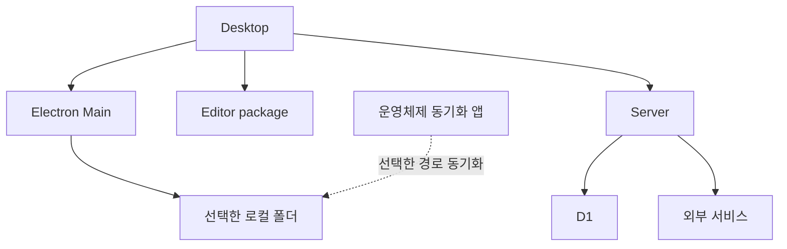

# 시스템 개요

Workspace는 Desktop 앱, 선택적으로 사용하는 Server, 공유 Editor package로 구성된다. Desktop은 선택한 로컬 폴더와 OS 자원을 소유한다. 파일 동기화가 필요하면 운영체제의 동기화 앱이 관리하는 경로를 일반 로컬 폴더로 연다.

## 활성 실행 단위

| 단위 | 책임 | 경계 |
| --- | --- | --- |
| [Desktop](../../apps/desktop/README.md) | Editor, 파일 탐색, 터미널, 브라우저, 뷰어, 기기 정보 | Main이 OS 권한을 소유하고 preload가 제한된 API를 제공한다. |
| [Server](../../apps/server/README.md) | 외부 서비스 연결과 암호화된 자격 증명 저장 | 배포 환경에서 지정한 identity issuer와 공개 키로 인증한다. |
| [Editor](../../packages/editor/README.md) | 편집기 UI, 문서 surface, tree/provider 계약 | Desktop이 로컬 파일 provider를 연결한다. |

## 데이터 흐름

Desktop 저장과 외부 폴더 동기화는 서로 다른 책임이다. Editor는 로컬 파일을 읽고 쓴다. Google Drive 데스크톱 앱 등 사용자가 설치한 도구가 동기화와 동기화 충돌을 관리한다.

## 불변식

- 권한이 필요한 파일·프로세스·네이티브 작업은 Desktop Main에서 수행한다.
- 저장된 파일의 기준 위치는 선택한 로컬 경로다.
- Server 자격 증명은 암호화해 서버 저장소에 두고 Renderer에 노출하지 않는다.
- 저장 성공, 서버 API 성공, 외부 동기화 완료는 서로 다른 상태다.
- 이전 기능 자료는 archive에 보존하며 활성 모듈이나 빌드 입력으로 사용하지 않는다.

현재 module/source 추적 정보는 [스펙 인덱스](./spec-index.json), 제품 여정은 [프로젝트 정의](../product/프로젝트%20정의.md)를 참고한다.
