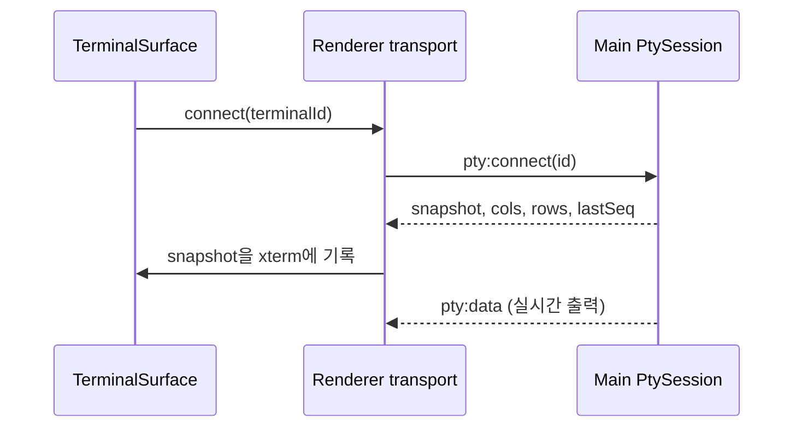

# 프로세스와 IPC

## Preload bridge

`apps/workspace-app/src/preload/index.ts`는 `window.electron`과 `window.api`에 형식이 지정된 API를 노출합니다. Renderer 코드는 `apps/workspace-app/src/renderer/src/electron.ts`의 보조 함수를 통해 이 API를 호출합니다.

Context isolation이 켜져 있으므로 Renderer는 Node 모듈을 직접 가져올 수 없습니다.

## Workspace IPC

| 채널 | 방향 | 목적 |
|------|------|------|
| `workspace:get-state` | invoke → Main | 최초 상태 불러오기 |
| `workspace:updated` | Main → Renderer 이벤트 | 상태가 바뀐 뒤 전체 상태 전달 |
| `workspace:add-tab` | invoke → Main | Workspace 탭 추가 |
| `workspace:close-tab` | invoke → Main | ID로 탭 닫기 |
| `workspace:select-tab` | invoke → Main | `activeTabId` 지정 |
| `workspace:set-tab-layout` | invoke → Main | flexlayout JSON 저장 |
| `workspace:set-tab-root-path` | invoke → Main | 탭의 기준 디렉터리 변경 |

Main 구현은 `apps/workspace-app/src/main/workspace.ts`, IPC handler는 `apps/workspace-app/src/main/index.ts`에 있습니다.

`persist()`는 `workspace.json`을 저장하고 `sendToMainWindow`를 통해 `workspace:updated`를 보냅니다. 이 함수는 macOS에서 창이 다시 만들어지는 경우도 처리합니다.

### Workspace 상태 형태

```typescript
{
  tabs: Array<{
    id: number;
    title: string;
    root_path: string;
    layout_json: string;  // 직렬화한 flexlayout IJsonModel
  }>;
  activeTabId: number;
}
```

Renderer의 `useWorkspace()`는 `active_tab_id`, `layout_json`, `root_path` 같은 snake_case 필드를 매핑합니다.

## PTY IPC

| 채널 | 방향 | 목적 |
|------|------|------|
| `pty:spawn` | invoke → Main | 터미널 ID와 셸 생성 |
| `pty:connect` | invoke → Main | Renderer 연결, 재생용 snapshot 반환 |
| `pty:disconnect` | send → Main | Renderer 연결 해제. PTY는 계속 실행 |
| `pty:data` | Main → Renderer | `{ id, seq, data }` 출력 조각 전달 |
| `pty:write` | send → Main | 셸에 입력 바이트 전달 |
| `pty:resize` | send → Main | 터미널 크기 변경(SIGWINCH) |
| `pty:dispose` | send → Main | 개별 PTY 종료에는 아직 연결되지 않음. 현재는 레이아웃 변경 시 orphan 세션을 정리합니다. |

Main의 `apps/workspace-app/src/main/ptySession.ts`에서 `PtySession`이 `Pty`를 감싸고 `PtyReplayBuffer`에 출력을 보관합니다. 버퍼 상한은 약 5,000행 × 120자입니다.

Renderer 코드는 `apps/workspace-app/src/renderer/src/terminal/ptyTransport.ts`와 `connectPanePty.ts`에 있습니다.

### 연결과 재연결



Workspace 탭이 숨겨지면 Renderer가 `pty:disconnect`를 보낼 수 있지만 Main은 PTY를 유지합니다. 다시 표시될 때 `pty:connect`로 버퍼 출력을 재생합니다.

## 파일시스템 IPC

요청은 Workspace 탭 ID와 `root_path` 아래의 상대 경로를 사용해 범위를 제한합니다.

- `fs:list-dir`, `fs:read-file`, `fs:write-file`
- `fs:create-dir`, `fs:delete-path`, `fs:rename-path`

`TreeView`와 편집기가 이 채널을 사용합니다.

## 브라우저 IPC

| 채널 | 목적 |
|------|------|
| `browser:open-new-tab` | guest의 `target=_blank` 요청으로 pane에 브라우저 탭 추가 |
| `shortcut:browser-reload` | Main에서 Cmd+R을 현재 브라우저로 전달 |
| guest focus relay | 단축키 대상이 될 webview를 추적 |

현재 브라우저 guest 등록 정보는 `apps/workspace-app/src/renderer/src/layout/activeBrowserWebview.ts`에 있습니다.

## PKMS IPC

PKMS desktop adapter는 기존 파일시스템 IPC와 별도 경로로 Worker API에 연결됩니다.

| 채널 | 목적 |
|------|------|
| `pkms:request` | 고정된 Worker의 `/api/*` 요청 및 device-flow 인증 |
| `pkms:fetch-asset` | 인증된 workspace attachment 읽기 |
| `pkms:open-verification` | GitHub device verification 페이지 열기 |

채널 타입은 `apps/workspace-app/src/shared/pkmsClient.ts`, preload 노출은 `apps/workspace-app/src/preload/index.ts`, Main 처리는 `apps/workspace-app/src/main/pkms/`에 있습니다. Main이 bearer token을 보관하므로 renderer에는 token을 전달하지 않습니다. 전체 Web/iOS/Desktop 경계와 캐시 동작은 [PKMS integration](./07-pkms-integration.md)을 참고하세요.

## 클립보드

- `clipboard:write-text` — 터미널 OSC 52 클립보드 쓰기
- Renderer의 `electron.ts`에 있는 `writeClipboardText`

## 오류 처리

- Renderer 전역 오류: `installGlobalErrorLogging()` → `ErrorLogPanel`
- Pane 렌더링 오류: flexlayout factory 노드별 `PaneErrorBoundary`

## 관련 문서

- [터미널 파이프라인](./05-terminal-pipeline.md)
- [브라우저 embed](./06-browser-embeds.md)
