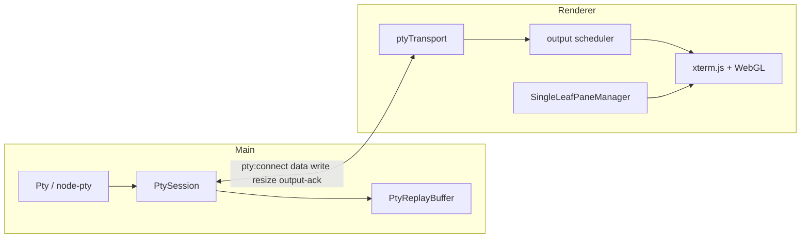

# Terminal pipeline

## Reference-port decision: port a working terminal feature, not its appearance

**Status: implementation in progress.** Orca is the behavioral reference. Workspace keeps
its current Electron IPC, one-terminal-per-pane UI, and local PTY host, but those adapters
must preserve Orca's terminal contracts end to end.

The current implementation is not yet feature-equivalent. In particular, Orca's output
scheduler is a coordinated queue, parse-progress, backpressure, and stalled-write recovery
system. Workspace currently replaces it with a smaller animation-frame coalescer. That
removes queue priority, throughput budgeting, pipeline health/recovery, and the parse barrier.
The existing scroll-intent helpers do not compensate for those missing output/lifecycle
contracts. The PTY transport preserves bytes through its local socket, then `PtySession`
decodes and re-encodes them before renderer delivery; this creates an avoidable second text
boundary and requires live output and snapshot replay to agree exactly about decoder state.

These are concrete architectural risks consistent with the reported failures, not yet a
confirmed single cause for every scroll, glyph, or color symptom. Color rendering also
depends on shell capabilities (`TERM`, `COLORTERM`), preserving ANSI bytes, and applying
the active xterm theme; each needs an end-to-end check instead of being inferred from config.

### Porting contract

Treat the terminal as one vertical slice with these invariants:

1. PTY output bytes are ordered and lossless from shell through IPC into one UTF-8 decoder;
   snapshot replay and live data share the same sequence/decoder boundary.
2. xterm parsing has bounded queues, acknowledgements on parse or discard, fairness between
   foreground/background panes, and explicit stalled-parser recovery.
3. Scroll position follows xterm's user-scroll state for live writes. Structural changes
   (reattach/replay/refit) restore a saved viewport only after parsing and fitting settle.
4. Color capability is consistent across PTY environment, ANSI bytes, xterm options, and
   resolved theme. Unicode width/font behavior is verified with Hangul, emoji, and Nerd Font.
5. Hiding/remounting a pane never loses sequence state, pending output credit, or scroll intent.

### Progress

- [x] Output scheduler dependency closure ported (queueing, fair drain, parse barrier,
  backlog bounds, ACK release, and stalled-write health/recovery). Adapted to Workspace's
  PTY ACK API and pane disposal. The focused Orca scheduler suite passes: 104 tests.
- [ ] Byte ownership and live/replay decoder contract
- [ ] Replay/refit/scroll lifecycle parity
- [ ] Installed-build checks for scroll, UTF-8, and ANSI colors

### Implementation order

1. Port Orca's output-scheduler dependency closure and its tests, adapting only imports,
   PTY acknowledgement, and Workspace pane lifecycle. Do not retain the simplified scheduler
   alongside the port.
2. Port the byte/sequence ownership contract through PTY host → main → renderer and align
   live delivery with snapshot replay. Keep terminal query filtering explicit and byte-safe.
3. Port replay/fit/scroll restoration as one lifecycle contract, then verify wheel behavior
   both with and without TUI mouse reporting.
4. Verify theme/ANSI/Unicode/font behavior from an actual shell session and fix the first
   failing boundary found. Keep the per-chunk terminal trace disabled in normal production;
   use bounded opt-in diagnostics for fault reports.
5. Run relevant tests and build, then manually exercise long scrollback, high-rate colored
   output, split Hangul/emoji output, pane hide/show, and reconnect before claiming parity.

The app is complete only when these invariants pass in the installed build. Porting a module
or matching Orca's visual layout alone is not acceptance evidence.

Terminal rendering follows an Orca-inspired **session vs mount** split: the shell PTY lives in main; xterm.js is a mount that can suspend without killing the session.

## Data flow



## PTY host and main process

The main Electron process is a client of a detached local PTY host. The host
owns shell processes and a bounded raw output replay buffer, so Cmd+Q can close
the UI process while shells and foreground TUIs keep running. On the next
launch, the main process reattaches by stable terminal id and seeds xterm from
the host replay. Closing the last pane that references a terminal explicitly
destroys that PTY session. If the machine itself restarts or the host exits,
the saved xterm scrollback remains the fallback, but the old command process
cannot be resumed.

| File | Role |
|------|------|
| `apps/workspace-app/src/main/pty.ts` | Main-process client for the detached PTY host |
| `apps/workspace-app/src/main/ptyHostDaemon.ts` | Detached PTY owner and bounded output replay |
| `apps/workspace-app/src/main/ptySession.ts` | `PtySession`, local replay, attach/detach |
| `apps/workspace-app/src/main/workspace.ts` | `TerminalEntry` map, spawn on layout restore |

`PtyReplayBuffer` retains ~5000×120 characters for reconnect replay. Output while disconnected is still buffered.

`pty:connect` returns:

```typescript
{
  id, snapshot, snapshotCols, snapshotRows, lastSeq, isReattach
}
```

## Renderer transport

| File | Role |
|------|------|
| `terminal/ptyTransport.ts` | IPC connect, seq-numbered output |
| `terminal/ptyInputWriteQueue.ts` | Batched input writes |
| `terminal/connectPanePty.ts` | Wires transport → scheduler → xterm; OSC 52; resize |

On connect: replay snapshot, `refitPaneTerminal`, `ptyResize`.

Resize: `pane-fit-resize-observer` + `setPaneFitListener` for PTY sync (not a duplicate ResizeObserver in connectPanePty).

## Pane manager (single-leaf subset)

Directory: `apps/workspace-app/src/renderer/src/lib/pane-manager/`

Orca’s full split/divider PaneManager was reduced to **one xterm per pane**:

| Module | Role |
|--------|------|
| `single-leaf-pane-manager.ts` | Public API: create pane, refit, suspend/resume |
| `pane-dom-creation.ts` | xterm + addons (fit, search, serialize, unicode11, weblinks) |
| `terminal-stable-cell-fit-addon.ts` | Fits rows/columns from measured cell dimensions, independent of the previous PTY grid |
| `pane-lifecycle.ts` | `openTerminal`, initial fit RAF loop |
| `pane-terminal-refit.ts` | `refitPaneTerminal` — fit + WebGL rebuild on resize |
| `pane-webgl-renderer.ts` | WebGL attach/dispose, context loss |
| `pane-rendering-control.ts` | `safeFit`, suspend/resume |
| `pane-terminal-output-scheduler.ts` | Ordered foreground output queue; never drops partial terminal control sequences |
| `pane-fit-resize-observer.ts` | ResizeObserver on `xtermContainer` |

### WebGL / GPU

- `@xterm/addon-webgl` beta aligned with Orca; patches in `apps/workspace-app/patches/`
- `terminalGpuAcceleration: "auto"` in `TerminalPane` (WebGL via `@xterm/addon-webgl`)
- Wheel events scroll xterm history when no app has enabled mouse reporting; mouse-reporting TUIs receive calibrated wheel reports in either buffer (`terminal-wheel-scroll.ts`, `pane-terminal-mouse-wheel.ts`)
- On resize: `refitPaneTerminal` disposes and re-attaches WebGL to avoid tiny-canvas glitches
- On hide: `suspendPaneRendering` disposes WebGL; resume refits and re-attaches
- Renderer acknowledges each output chunk after xterm parses it. At 512 KiB unparsed output the PTY host pauses reads; it resumes below 128 KiB. This bounds renderer pressure without discarding terminal bytes.

### Visibility / suspend

`TerminalSurface.tsx`:

```typescript
visible && active  // from PaneGroup + pane tab active
```

When false: `manager.setRenderingSuspended(true)` — WebGL off, deferred attachment.

When true: resume, refit, `ptyResize`, `terminal.focus()`.

## UI components

| File | Role |
|------|------|
| `panes/TerminalPane.tsx` | Thin wrapper |
| `panes/TerminalSurface.tsx` | Host div, manager lifecycle, search, theme |
| `components/TerminalSearch.tsx` | xterm search addon UI |
| `terminalThemes.ts` | Ghostty/Tango xterm themes |

## Themes

`XTERM_THEMES` keyed by resolved app theme; subscribed via `subscribeThemeChange`.

## Search

Cmd+F when terminal focused → `TerminalSearch` bar (not body-portaled; registers portal for dismiss on workspace switch).

Safe find wrapper: `terminalSearchSafeFind.ts` — limits query size.

## xterm dependencies

Declared in `apps/workspace-app/package.json`:

- `@xterm/xterm`, `@xterm/addon-fit`, `@xterm/addon-search`, `@xterm/addon-serialize`
- `@xterm/addon-unicode11`, `@xterm/addon-web-links`, `@xterm/addon-webgl`, `@xterm/addon-ligatures`

Post-install: `apps/workspace-app/scripts/apply-xterm-patch.mjs`

## Debugging terminal display

| Symptom | Check |
|---------|-------|
| Blank gray pane, tiny glyph corner | WebGL wrong size — `refitPaneTerminal` path; resize window |
| No input | PTY connected? `pty:connect` errors in ErrorLogPanel |
| Wrong size after tab switch | `refitPaneTerminal` on resume; `ptyResize` after fit |
| Scroll/TUI broken after switch | Ensure not unmounting xterm on workspace switch |

## Related docs

- [02-process-and-ipc.md](./02-process-and-ipc.md)
- [04-interaction-coordinator.md](./04-interaction-coordinator.md)
