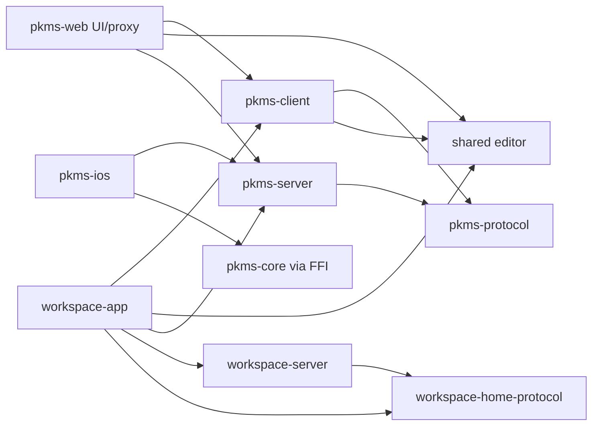

# 제품별 앱 경계

`apps/`는 실행·배포 가능한 제품 앱을 둡니다. `packages/`는 둘 이상의 앱이 실제로 공유하는 코드와 계약을 둡니다. 앱 내부 코드는 기능 책임을 따라 나누고, 저장소 전체를 `frontend/`, `backend/` 같은 기술 계층으로 나누지 않습니다.

## 목표 구조

```text
apps/
  pkms-web/                 # PKMS 브라우저 UI
  pkms-server/              # 여러 PKMS 클라이언트를 위한 API·인증·MCP·동기화 Worker
  pkms-ios/                 # PKMS iOS 앱
  workspace-app/            # Electron 셸, 파일·PTY 권한, Home 대시보드 UI
  workspace-server/         # Home 서비스 연결·상태 API와 provider OAuth Worker

packages/
  editor/                    # Workspace와 PKMS Web/Desktop이 공유하는 편집기 UI와 provider 계약
  pkms-client/              # Web/Desktop에서 공유하는 PKMS 클라이언트 UI와 동작
  pkms-protocol/            # PKMS HTTP·Realtime 계약
  workspace-home-protocol/  # Workspace Home API 계약
  pkms-core/                # 플랫폼 독립 문서·경로 규칙과 FFI/WASM 구현
```

`workspace-server`는 Home 대시보드가 Cloudflare·Supabase 등의 외부 서비스 상태를 보여주고 계정을 연결하는 데 필요한 서버입니다. Workspace의 범용 백엔드나 Electron의 로컬 기능을 서버로 옮긴다는 뜻은 아닙니다.

## 소유권과 의존 방향

| 앱/패키지 | 소유 책임 |
|---|---|
| `apps/pkms-web` | PKMS 웹 UI, React Router SSR, browser API same-origin proxy |
| `apps/pkms-server` | PKMS 세션·저장소/문서 API·협업·GitHub 백업·MCP·Realtime/Home token 발급 |
| `apps/pkms-ios` | iOS UI·Keychain 세션·네이티브 생명주기·Rust FFI 연결 |
| `apps/workspace-app` | Electron UI·파일시스템/PTY 권한·IPC·Home 화면과 로컬 위젯 |
| `apps/workspace-server` | Home provider 연결/OAuth·상태 조회·provider 자격 증명 보관 |
| `packages/editor` | 파일 provider에 독립적인 공통 편집기, CodeMirror 편집, 트리·탐색 UI와 provider 계약 |
| `packages/pkms-client` | PKMS 로그인·저장소 선택, 문서 provider와 PKMS 클라이언트 로직. 공통 Editor UI는 `packages/editor`가 소유 |
| `packages/pkms-protocol` | PKMS API와 Realtime의 언어 중립 계약 및 TypeScript 타입 |
| `packages/workspace-home-protocol` | Workspace Home 서버와 Desktop 사이의 API 계약 |
| `packages/pkms-core` | 네트워크/서비스에 의존하지 않는 PKMS 도메인 규칙 |

앱은 패키지를 가져올 수 있지만 패키지는 앱 코드를 가져오지 않습니다. PKMS와 Workspace Home은 서로 다른 제품·인증·자격 증명 경계입니다. Workspace Home 서버는 PKMS 세션 비밀이나 PKMS 저장소 데이터에 접근하지 않고, PKMS가 발급하는 짧은 audience 제한 토큰으로 사용자를 확인합니다.

Editor UI는 제품 간 공유 패키지 `packages/editor`가 소유합니다. PKMS 계정·저장소와 Yjs 데이터 연결은 `packages/pkms-client`, 로컬 파일 접근은 `apps/workspace-app`의 provider가 소유합니다. 세부 계약과 이전 순서는 [Editor 통합 스펙](../planning/editor-unification.md)을 따릅니다.



## 배포 경계

각 `apps/<product>`는 독립적으로 설정하고 검증할 수 있어야 합니다. `pkms-web`과 `pkms-server`는 서로 다른 소비자와 책임을 가지므로 소스·설정·배포 작업을 분리합니다. `workspace-app`과 `workspace-server`도 같은 원칙을 따릅니다. 여러 앱을 한 호스트나 저장소에서 배포하는 선택은 앱의 코드 소유권을 합치지 않습니다.

PKMS Web UI와 PKMS API는 각각 `apps/pkms-web`과 `apps/pkms-server`에서 빌드·배포합니다. 사용자 주소는 기존 `pkms-cloud` origin으로 유지합니다. PKMS API Worker가 API 요청과 세션을 처리하고 페이지 요청을 Web Worker로 전달하므로 host-only 세션 쿠키와 기존 GitHub OAuth callback을 보존합니다. `pkms-web`은 별도 배포되며 직접 접근을 canonical origin으로 redirect합니다. Workspace Home 화면과 API는 `apps/workspace-app`과 `apps/workspace-server`에 있습니다. Home provider OAuth secrets와 callback 설정은 별도 구성 대기 상태입니다.

## 이전 순서

1. **완료:** Home 대시보드를 복구하고 `apps/workspace-server` Worker와 전용 D1을 만들었다. 기존 provider grant는 옮기지 않고 Workspace 서버에서 다시 연결한다.
2. **완료:** PKMS가 5분짜리 `workspace-home` audience token을 발급한다. Electron Main이 이를 받아 Workspace Home API에 전달하며 renderer에는 PKMS 세션이나 bearer token을 노출하지 않는다.
3. **배포됨, provider 연결 설정 대기:** `pkms-cloud`와 `workspace-home` API Worker는 서로 다른 배포다. Workspace Worker에 Cloudflare/Supabase OAuth client secrets를 등록하고 provider callback URL을 바꾼 뒤 연결을 확인한다.
4. **배포됨:** `apps/pkms-web`은 UI를, `apps/pkms-server`는 shared PKMS API를 소유한다. `pkms-cloud` 기존 Worker 이름과 secrets는 API 서버에 보존하고 페이지 요청을 Web Worker로 전달한다.
5. **구현됨:** Electron과 iOS 폴더를 각각 `apps/workspace-app`, `apps/pkms-ios`로 옮기고 패키지 스크립트, CI 경로 필터, 문서와 앱 내부 경로를 갱신했다.

한 번에 디렉터리 이름만 바꾸지 않습니다. 각 단계에서 빌드·개발·배포 경계를 검증하고, 완료한 경계만 기능 상태에서 `implemented`로 표시합니다.
