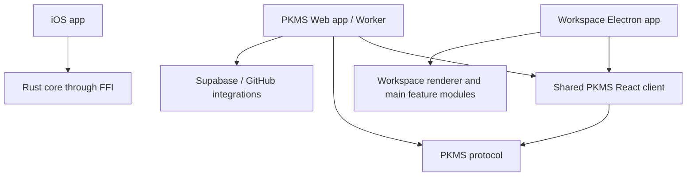

# Monorepo module boundaries

This repository contains three applications with different runtime and security needs. They share contracts and platform independent rules where the code is genuinely common; each application owns its UI, lifecycle, credentials, and integrations.

## Repository map

| Area | Owns | Depends on |
|---|---|---|
| `apps/workspace` | Electron shell, panes, filesystem/PTY access, IPC registration, secure desktop session | Workspace libraries; shared PKMS client source for the PKMS pane |
| `apps/web` | Web route adapter, Cloudflare Worker, Supabase and GitHub service integrations | `@pkms/client`, `@pkms/protocol` |
| `apps/ios` | SwiftUI, iOS lifecycle, Keychain-backed session, native Rust bridge | `pkms-core` through FFI; HTTP/Realtime wire contract |
| `packages/pkms-client` | React UI shared by Web and Desktop, client-side collaboration and local cache | `@pkms/protocol`; React peer dependencies; platform adapters |
| `packages/pkms-protocol` | HTTP and Realtime wire types alongside language-neutral OpenAPI/JSON Schema | No application code |
| `packages/pkms-core` | Path rules and Yjs-compatible document operations, exported through WASM and FFI | No application code or network services |

The dependency direction is inward: applications compose packages; packages do not import application code. Platform security and storage stay in the owning app.

## Runtime boundaries

### Workspace desktop

`apps/workspace/src/main/index.ts` is the Electron composition root. Feature IPC registrations live under `src/main/ipc/`; terminal and tab/filesystem/search handlers are registered there. The renderer talks to Main through the preload bridge. Main validates requests and owns privileged operations such as filesystem access and PKMS session tokens.

The PKMS pane mounts the same React client used by Web. `packages/pkms-client/src/platform/desktopApi.ts` selects the IPC adapter when it runs inside Electron. It never receives the stored bearer token.

### Web and service

`apps/web/app/` adapts React Router to the shared client. `apps/web/workers/` owns authentication, authorization, API routing, persistence, GitHub backup, and Realtime token issuance. These server responsibilities must not move into the React package.

### iOS

`apps/ios/PKMSProtocolModels.swift` contains HTTP and Realtime DTOs. `PKMSModel.swift` owns observable app state and coordinates API, session, and Realtime adapters. `NativeMarkdownDocument.swift` wraps the Rust FFI document model. SwiftUI views remain in the iOS app.

### Shared contracts and domain rules

`packages/pkms-protocol/openapi.yaml` and `realtime.schema.json` describe the language-neutral wire contract. `src/types.ts` is the TypeScript view consumed by the Worker and React client. Keep those definitions aligned; generate TypeScript and Swift models from the schemas in a later step to remove the remaining manual synchronization.

`packages/pkms-core/crates/pkms-core` owns platform-independent path validation and Yjs/Yrs document behavior. The WASM and FFI crates expose that behavior to browser and iOS runtimes. It does not own HTTP, GitHub, Supabase, or UI state.

## Client package modules

`packages/pkms-client/src/` is being separated by responsibility:

- `domain/` holds typed client models and pure file-tree, path, filter, encoding, and document helpers.
- `client/` holds API transport and revisioned file-operation requests shared by Web and Desktop.
- `platform/` adapts the same client to Electron IPC.
- `components/` holds leaf UI such as icons and the Markdown editor.
- `PkmsClientApp.tsx` still composes most feature state and screens. Continue splitting account, repository, file browser state/actions, editor, and sync features without changing its public Web/Desktop entry point.

## Refactoring progress

The first modularization pass has:

- moved PKMS client pure helpers into `domain/`, API transport into `client/`, and leaf icons into `components/`;
- extracted the file-tree list view and a shared revisioned file-operation request module;
- extracted tree focus, multi-selection, range-selection, and cut-selection state into `features/files/useFileTreeSelection.ts`;
- moved Workspace tab/filesystem/search and PTY registration out of `main/index.ts` into `main/ipc/`;
- introduced shared TypeScript API and Realtime models in `@pkms/protocol` for the Worker and React client;
- moved iOS wire DTOs out of `PKMSModel.swift` into `PKMSProtocolModels.swift`.

The next steps are:

1. Continue splitting `PkmsClientApp.tsx` into account, repository, file browser state/actions, editor, and sync feature hooks while keeping the Web/Desktop entry point stable.
2. Split the iOS state model into API, auth, document, and Realtime coordinators.
3. Separate Worker routing into auth, workspace API, MCP, and scheduled sync modules.
4. Generate client DTOs from the language-neutral schemas and add contract checks before changing the wire format.
5. Review repeated Markdown editor behavior between Workspace and PKMS; extract only the CodeMirror behavior that can be shared without coupling either app's styles or lifecycle.

Each step should preserve the current API, database schema, deployment bindings, and iOS FFI contract. A module move alone must not alter authorization, persistence, or sync semantics.
