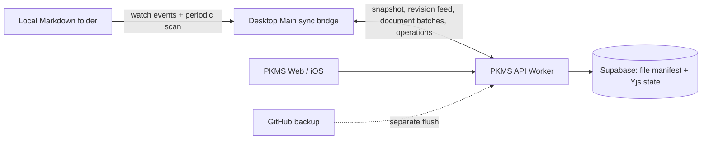

# PKMS Desktop folder sync

This is the authoritative description of how the Desktop folder sync works. It describes the current implementation; it is not a promise that all latency goals are met. Update this document when changing sync behavior, then implement against the documented rules.

## At a glance

The connected local Markdown folder is the Desktop user's editable file source. The PKMS server remains the shared cloud source for other devices. The Desktop Main process reconciles the two using local SHA-256 content hashes, cloud file revisions, and a persisted common baseline. GitHub backup is a separate server process and is not part of folder sync completion.

Implementation: `apps/workspace-app/src/main/pkms/syncBridge.ts`; server protocol: `apps/pkms-server/src/SupabaseVault.ts`; persistence: `apps/workspace-app/src/main/pkms/pkms-sync-bridge.json` under Electron `userData`.

## Ownership and persisted state

| State | Meaning |
|---|---|
| Local file | User-editable Markdown bytes in the connected folder. PKMS pane local-file operations and external editors both change this source. |
| Remote manifest | Cloud file IDs, paths, kinds, revisions, and optional Git blob SHA used to detect cloud changes and locate files. |
| Baseline | For each reconciled path, the last shared file ID, local content hash, and cloud revision. This is the common ancestor used to distinguish one-sided changes from concurrent changes. |
| Sync cursor | Highest cloud workspace revision fully enumerated by the Desktop bridge. |
| Yjs document state | Cloud collaborative document source of truth. The server's Markdown content cache is a revision-matched projection used for efficient batch reads. |
| GitHub mirror / backup | Separate import and delayed push workflow. A successful folder sync does not mean the GitHub backup queue is empty. |

The bridge stores folder configuration, exclusions, baselines, remote manifest, and revision cursor in an atomically replaced JSON file with mode `0600`. A filesystem lock keyed by canonical folder path prevents two Workspace processes from syncing the same folder concurrently.

## Reconciliation rules

The bridge compares the local hash with the baseline hash and the remote ID/revision with the baseline ID/revision:

| Local state | Cloud state | Result |
|---|---|---|
| New local path; no baseline or remote path | Absent | Create the cloud document at that path. The server checks path uniqueness atomically and returns a conflict path if another client claimed it. |
| Local changed | Cloud unchanged | Apply the local text change to the Yjs document, then advance the baseline. |
| Local unchanged | Cloud changed | Write cloud text atomically to the local path, then advance the baseline. |
| Both changed | Both changed | Preserve local bytes in a `.local-conflict-…` file and put the cloud version at the original path. Record baselines for both. |
| Local file deleted | Cloud unchanged | Delete the cloud document. |
| Local file deleted | Cloud changed | Preserve the latest cloud text in a conflict copy, then delete the cloud document. |
| Local file exists; cloud entry deleted | Local unchanged | Remove the local file. |
| Local file exists; cloud entry deleted | Local changed | Preserve local text as a conflict copy, then remove the original local path. |
| No baseline; imported GitHub file SHA matches local Git blob hash | Same imported revision | Seed the baseline without downloading the document body. |

Atomic local writes use a temporary sibling file and rename. Before replacing/removing a file, the bridge checks its expected hash so a concurrent external edit is retried rather than overwritten. Cloud document updates read the latest Yjs state and verify it still matches the expected text before applying a minimal prefix/suffix edit. Server operations carry IDs for deduplication; stale deletes are idempotent.

Conflict copies are preserved as data, not automatically merged. Users should review them; duplicate copies are not evidence that their contents are redundant.

## Scheduling and performance behavior

| Trigger | Current behavior |
|---|---|
| Native recursive filesystem event | Queue the affected path and start a reconciliation after a 25 ms debounce. A null/invalid event or watcher failure requests a full scan. |
| Cloud revision polling | Every 750 ms, queue a metadata-only revision-feed check. If the cursor and manifest are current and there are no changed paths, do not walk the local tree or rewrite baseline state. |
| Recovery scan | Walk the local Markdown tree every 15 minutes, and at startup/reconfiguration. |
| Initial cloud enumeration | Read a revision-pinned snapshot in pages of up to 1,000 Markdown entries. Imported Git blob SHA can avoid fetching unchanged bodies. |
| Changed cloud document bodies | Request up to 32 IDs per batch, up to 4 batches concurrently; reconcile up to 6 paths concurrently. |
| Retryable error | Retry with exponential delay starting at 1 second and capped at 60 seconds. Pending local paths and full-scan requests are retained. |

The `<1 second` target applies to a normal one-file local edit reaching the cloud, and a normal cloud edit reaching an idle Desktop, under a healthy network and an already initialized bridge. It is currently **not verified as met**: recent observed local-to-cloud single-file latency was approximately 2–3 seconds. The frequent revision poll can contend with local work; that queueing behavior is still a performance issue to resolve. Initial sync of thousands of files is a separate workload and has no sub-second completion target.

Displayed progress counts work in the current pass. It is not a monotonic lifetime counter: a retry or a new pass can change its denominator. A completed pass reports 100%; while another pass is queued, the status can return to syncing. `Last synced` refers to the last completed bridge reconciliation, not GitHub backup completion.

## Server protocol

| Endpoint | Purpose |
|---|---|
| `GET /snapshot?atRevision=&afterPath=` | Enumerate live Markdown metadata as of one fixed revision; 1,000 entries per page. |
| `GET /sync/changes?afterRevision=&lastRevision=&lastFileId=` | Enumerate revisioned file metadata/tombstones; 500 entries per page with a stable tie-break cursor. |
| `POST /sync/download` | Fetch up to 32 Markdown bodies in one request. Uses the revision-matched content cache, falling back to Yjs state reconstruction when needed. |
| `POST /operations` | Create, move, or delete files with operation ID and base revision. Conflict handling and path uniqueness are server-side. |
| `GET/POST /files/:id/updates` | Read Yjs state and append collaborative document updates. |

The cursor advances to the server revision only after the bridge has consumed the complete page set. A snapshot is pinned to its starting revision so later writes are picked up by a subsequent change-feed pass.

## Exclusions and recovery

The bridge excludes reserved paths such as `.git`, `.obsidian`, `node_modules`, and `.pkms`, then applies user exclusion patterns. Only Markdown files participate in folder content sync; attachments and GitHub backup have separate behavior. Full scans recover missed native watcher events. If local and cloud state cannot be reconciled safely, the pass remains pending and retries or reports an error; the bridge must not silently advance the baseline.

## Specification-driven change checklist

For a sync behavior change, update this document in the same change and review:

1. Which side owns the user's edit and what baseline/cursor advances?
2. What happens if the same path changes or disappears on both sides?
3. Is a retry idempotent after a request succeeded but its response was lost?
4. Can watcher events generated by our own atomic writes cause a loop or hide an external edit?
5. Does displayed progress describe one pass, and is the latency target measured separately from GitHub backup?

Current schedule values and endpoint page limits above must match code. Do not add speculative values here.
