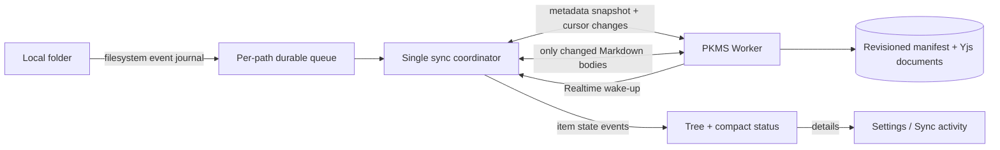

# PKMS Desktop folder sync

This is the source of truth for the folder-sync algorithm and its user experience. It separates the current implementation from the target design. Product behavior changes must update this specification before or with code.

## Product decision

The connected folder stays a normal, fully materialized local folder. PKMS pane edits and external editors operate on the same files. The cloud stores the shared Markdown documents and revisioned metadata. GitHub backup is a separate, optional export path; it does not determine whether local/cloud sync is complete.

The goal is a responsive, predictable experience with clear per-file state. **There is no arbitrary one-second completion requirement.** Render local files immediately; let metadata and file transfers progress independently; never hold the tree behind a full sync or show a changing aggregate percentage as if it were a stable measure.

## Current implementation

Implementation lives in `apps/workspace-app/src/main/pkms/syncBridge.ts`; Worker routes and reconciliation support live in `apps/pkms-server/src/SupabaseVault.ts`; the current status panel is `packages/pkms-client/src/components/SyncBridgePanel.tsx`.

The Desktop Main process persists folder configuration, local SHA-256 baselines, remote Markdown manifest, and server revision cursor in `pkms-sync-bridge.json` under Electron `userData`. A folder lock prevents two Workspace processes from syncing the same folder at once.

| Trigger | Current behavior |
|---|---|
| Local filesystem event | Recursive `fs.watch` queues paths; a 25 ms debounce starts one serialized pass. Unusable watcher events request a full scan. |
| Cloud changes | Desktop subscribes to the private `pkms:{workspaceId}` Realtime channel with a short-lived Worker-issued token. Broadcasts wake the coordinator; authoritative changes still come from the revision cursor. A 30-second poll recovers missed events and unavailable Realtime sessions. Reconnect triggers cursor catch-up. |
| Recovery | A complete local Markdown walk runs every 15 minutes and at startup/reconfiguration. |
| Initial remote inventory | `/sync/tree` reads Markdown and folder metadata (including empty folders), pinned to a server revision, 1,000 entries per page. The bridge caches this independently from Markdown bodies and returns it to the Desktop tree with a baseline/revision freshness hint. |
| Content transfer | `/sync/download` accepts up to 32 Markdown IDs. Up to 4 batches and 6 path reconciliations run concurrently. Imported Git blob SHAs can avoid unchanged body reads. |
| Retry | Retryable failures use exponential delay starting at 1 second, capped at 60 seconds. |

The Desktop bridge reads `/sync/tree` for the revision-pinned metadata tree and `/sync/changes` for subsequent metadata. `/snapshot` remains available to older consumers. If a deployed Worker does not yet expose `/sync/tree`, Desktop falls back to `/snapshot` and infers non-empty folders from Markdown paths; explicit empty-folder metadata requires the updated Worker. The version sent over IPC is a local cache version that also changes when baseline freshness changes; it is not the server sync cursor.

The local file tree is populated from filesystem IPC for the root and expanded folders, then merged with the cached cloud metadata tree. Cloud Markdown items without a matching local baseline file ID and revision are shown as waiting to sync; local rows take precedence when both sources contain the same path. Main forwards filesystem watch invalidations to the renderer, which coalesces them before refreshing the tree; a 30-second refresh remains as recovery. Cloud folder metadata is materialized locally, including empty folders; observed local directory creation is mirrored to cloud with `create-folder`. A missing Markdown file with a baseline can currently issue a remote delete, but its delete intent and cache cleanup are not durable. Local directory deletion is not sent to cloud, so empty folder metadata is rematerialized. The Files view keeps a compact global state and in-memory per-path markers for pending, active, or failed local work; detailed progress, exclusions, conflicts, and GitHub controls live in Sync settings. Pending local paths, file creates, and Yjs updates are persisted before network mutations. Retried creates/updates reuse operation IDs and payloads. File/folder delete safety, durable visual item-state restoration, attachment sync, and multi-device acceptance remain gaps. The delete algorithm and contract live in [Local deletion sync](./local-deletion-sync.md).

The bridge compares local content hashes and remote revisions against a persisted common baseline. A local-only edit uploads; a remote-only edit writes locally; a two-sided edit preserves local bytes in a conflict copy and places the cloud version at the original path. Deletes use the same baseline comparison. Cloud document state is Yjs; the revision-matched Markdown cache is used for efficient reads. Full reconciliation rules remain in code until the target durable queue and item-state implementation replaces them; do not infer undocumented behavior from this summary.

**File and folder deletion share one incomplete sync contract.** Missing Markdown records can be deleted individually in one reconciliation branch, but their operation ID/cache lifecycle is not durable; directory deletion is not inferred or sent at all. The target detection, pending intent, concurrency guard, retry, and acceptance contract is defined in [Local deletion sync](./local-deletion-sync.md). This is the SDD for the next deletion implementation slice.

### Sync endpoints

| Endpoint | Current responsibility |
|---|---|
| `GET /sync/tree?atRevision=&afterPath=` | Paginated Markdown and folder metadata, pinned to one revision. No bodies. |
| `GET /sync/changes?afterRevision=&lastRevision=&lastFileId=` | Revision changes and tombstones after the bridge cursor. |
| `POST /sync/download` | Fetch up to 32 Markdown bodies per request, using the revision-matched content cache where possible. |
| `POST /operations` | Apply revisioned create, move, and delete operations. |
| `GET/POST /files/:id/updates` | Read and append Yjs document updates. |

## Research findings applied to this design

Apple File Provider separates item metadata from materialized content, paginates directory enumeration, and enumerates only changes after a sync anchor. It also distinguishes pending items from the complete working set. iCloud exposes per-file states such as waiting to upload, downloaded, and transfer progress. Google Drive gives users both a sync-activity surface and explicit stream/mirror modes. These patterns support a metadata-first tree, revision cursor, and concise per-item status.

We will keep **mirror semantics for content** because the selected local folder must work in PKMS and arbitrary local editors, including offline. We will adopt **metadata-first presentation**: display the tree from local/cached metadata while content reconciliation runs in the background. We will not introduce online-only placeholder files in the user's selected folder.

Sources:

- [Apple: Synchronizing the File Provider Extension](https://developer.apple.com/documentation/fileprovider/synchronizing-the-file-provider-extension)
- [Apple: Tracking Your File Provider’s Changes](https://developer.apple.com/documentation/fileprovider/tracking-your-file-provider-s-changes)
- [Apple: NSFileProviderSyncAnchor](https://developer.apple.com/documentation/fileprovider/nsfileprovidersyncanchor)
- [Apple Support: Check file and folder status in iCloud Drive on Mac](https://support.apple.com/en-euro/guide/mac-help/mchlc994344b/27/mac/27)
- [Google Drive Help: Sync status and recent activity](https://support.google.com/drive/answer/10838124)
- [Google Drive Help: Stream or mirror files](https://support.google.com/drive/answer/13401938)

## Target architecture

### Metadata first, content second

1. On startup, show the last known local tree immediately. Do not wait for content downloads or a complete reconciliation pass.
2. Load the cached cloud manifest and sync cursor. In the background, fetch a revision-pinned metadata tree. The tree contains explicit folders, including empty folders, plus Markdown IDs, paths, kinds, revisions, sizes, and content hashes where available. It contains no Markdown bodies.
3. Apply later metadata changes from a stable revision cursor. Use Realtime as a wake-up signal when connected, then fetch the authoritative cursor delta. Retain a slower polling fallback with backoff while idle/offline; polling is recovery, not the primary event path.
4. Reconcile bodies per path. Transfer only bodies whose known revision/hash differs from the local baseline. The selected local directory remains fully readable; background materialization brings cloud-only content into it.
5. Advance a cursor only after all metadata pages through the captured revision are durably applied. A new write after that revision belongs to the next pass.

The tree snapshot and content queue have separate lifecycles. A large first content download must not delay tree browsing, expansion, file creation, or the sync indicator.

### Local change capture and work queue

Replace broad repeated scans with a hybrid change pipeline:

- Native filesystem events identify changed paths. Coalesce bursts by path, not by whole workspace.
- Persist the pending path and operation identity before sending a cloud mutation. Retrying after a timeout reuses the same idempotency key.
- Keep one coordinator per connected folder, with bounded concurrency across independent paths and serialization for operations that depend on the same path or parent.
- Store per-path fingerprint metadata (`size`, modification time, and platform file identity when available). Read and hash content only for event paths or files whose fingerprint changed.
- Use periodic metadata reconciliation to recover missed events. Retain a less frequent deep audit for correctness where the platform watcher has no durable journal; it must not block the UI or ordinary change queue.
- Use cloud Realtime notifications to wake the coordinator. The revision feed remains the durable truth and reconnect catch-up mechanism.

Content hashing remains appropriate for Markdown equality and no-op detection. Block-level delta transfer is not the first optimization for small Markdown files; it adds protocol and recovery complexity while path-level change detection, request batching, and avoiding redundant reads address the observed workload. Revisit block transfer only if measurements show large-document bandwidth is a real bottleneck.

### Conflict and recovery contract

- Never silently overwrite edits made since the expected baseline.
- Compare local fingerprint/hash, baseline hash/revision, and remote file identity/revision before applying a change.
- Preserve both versions when both sides changed. Keep the original path's conflict policy deterministic and visible, and make conflict copies individually reviewable.
- Persist mutation operation IDs and queue state before network calls; server operations must be idempotent for retries after lost responses.
- Do not mark an item or folder up to date until its metadata and required content mutation are acknowledged and the new baseline is durable.
- A failed item remains pending/attention-needed without preventing unrelated paths from syncing.
- Rename/move is one logical operation with old and new parent metadata, not a delete/create pair that can multiply conflict copies.

## User experience contract

### Tree is the primary sync surface

The Files view stays focused on files. Keep local tree rows visible and interactive while sync runs. Show an indicator only for items needing attention:

| Item state | Tree presentation |
|---|---|
| `pending-upload` | Subtle waiting/upload icon or dot |
| `uploading` / `downloading` | Small animated transfer indicator |
| `conflict` | Conflict marker with a direct action to open the preserved copy |
| `attention` | Error marker; details and retry action in sync settings |
| `synced` | No per-row badge; the absence of a badge keeps the tree quiet |
| Folder | Aggregate the most important descendant state; do not count every child as a separate banner |

The initial metadata manifest lets the client identify cloud-only and not-yet-materialized items before their bodies arrive. Folder rows must exist even when empty. Local-only files are immediately visible and marked pending until their first cloud baseline is acknowledged.

### Detailed progress lives in settings

Move the full transfer queue, per-file errors, last successful reconciliation, exclusions, pause/resume, manual retry, and disconnect controls into **Settings → Sync**. Keep the global Files view to a compact state (for example, syncing count, offline, or needs attention) that opens the details. Keep GitHub backup under a separate subsection because it is not cloud sync.

Show queue counts and current activity instead of a global percent whose denominator can change. If a finite initial inventory transfer exposes a percentage, bind it to that fixed snapshot revision and label it as initial download progress. Never present GitHub pending files as folder-sync pending files.

## Rollout and acceptance

Implement in small spec-backed slices:

1. **Tree metadata contract:** implemented as `GET /sync/tree`, with revision-pinned Markdown and folder rows and path pagination. Existing `/snapshot` remains unchanged for clients that only consume Markdown entries.
2. **Tree-first UI:** implemented as cached metadata merged with local rows and Main-to-renderer watcher invalidations with a 30-second recovery refresh. Keep improving targeted directory refresh and event delivery across renderer reloads.
3. **Item-state contract:** persist per-path pending/syncing/conflict/attention state from Main to the tree provider; folders aggregate descendant state. The first UI slice already shows transient local work in rows and moves detailed global progress to Sync settings.
4. **Durable queue:** implemented for changed paths, file creates, and Yjs updates. The operation ID and payload are persisted before sending and reused after restart.
5. **Event-driven cloud catch-up:** implemented with private Supabase Realtime wake-up, Worker token refresh, cursor catch-up on subscribe, and a 30-second recovery poll.
6. **Folder metadata:** implemented for remote folder materialization and local folder creation. Define explicit safe rename/delete intent before enabling destructive directory operations.
7. **Measure:** capture cold-start tree-ready time, metadata catch-up, first local mutation acknowledgement, cloud-to-local materialization, queued-path count, bytes transferred, and conflicts. Set performance targets from these measurements rather than an arbitrary one-second requirement.

Acceptance requires the tree to remain usable during initial sync; no periodic empty-tree flash; a local new/edited/deleted file to show its state until acknowledged; remote additions/renames/deletes to update the correct rows; restart/retry not to duplicate mutations or conflict copies; concurrent edits to preserve both versions; and GitHub backup status to remain visibly separate.
