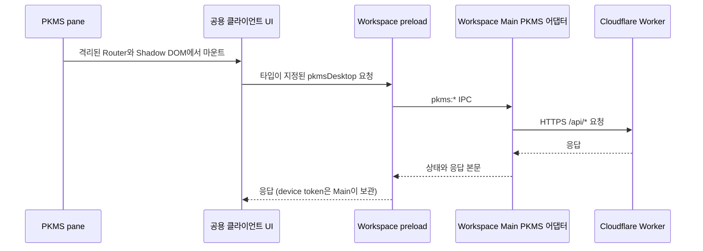

# PKMS 통합 구조

PKMS는 Workspace에 pane으로 들어오지만 기존 Cloudflare Worker를 사용하는 별도 서비스입니다. Worker, Supabase 데이터·Realtime, GitHub 동기화, Rust 코어, iOS 앱의 경계와 동작은 유지합니다.

## 코드 경계

| 역할 | 경로 | 책임 |
|---|---|---|
| pane 등록 | `apps/workspace-app/src/renderer/src/panes/kinds/pkmsKind.tsx` | Workspace pane registry와 picker에 PKMS 등록 |
| pane host | `apps/workspace-app/src/renderer/src/panes/pkms/PkmsPane.tsx` | 공용 클라이언트를 pane 전용 React root, `MemoryRouter`, Shadow DOM에서 마운트 |
| 공용 클라이언트 UI | `packages/pkms-client/src/PkmsClientApp.tsx` | 계정, 저장소 선택, 파일 트리, Markdown 편집, 첨부 파일, 로컬 캐시, Realtime UI 조립 |
| 클라이언트 도메인 | `packages/pkms-client/src/domain/` | 파일 트리·경로·필터·인코딩·문서 편집 규칙 |
| 클라이언트 API | `packages/pkms-client/src/client/` | Web 쿠키 요청과 Desktop IPC 요청을 연결하는 공용 transport |
| Web route adapter | `apps/pkms-web/app/routes/home.tsx` | Web 앱의 라우트 트리에서 공용 클라이언트 렌더링 |
| 공용 클라이언트 스타일 | `packages/pkms-client/src/styles.css` | Web과 격리된 Desktop pane이 함께 사용하는 스타일 |
| Desktop HTTP·Sync Bridge 어댑터 | `packages/pkms-client/src/platform/desktopApi.ts`, `apps/workspace-app/src/main/pkms/syncBridge.ts` | Desktop bridge가 있을 때 API 요청과 선택한 로컬 Markdown 폴더를 Main으로 연결. Web은 same-origin `fetch`를 사용하고 로컬 폴더 연결 기능은 제공하지 않음 |
| IPC 계약 | `apps/workspace-app/src/shared/pkmsClient.ts` | 요청, multipart 업로드, 첨부 파일 메시지 타입 |
| Preload bridge | `apps/workspace-app/src/preload/index.ts` | 범위가 제한된 `window.pkmsDesktop` API 노출 |
| Main IPC handler | `apps/workspace-app/src/main/pkms/ipc.ts` | renderer sender를 검증하고 요청, 첨부 파일, GitHub 인증 페이지 handler 등록 |
| Worker API client | `apps/workspace-app/src/main/pkms/api.ts` | 고정 Worker API 요청과 업로드·첨부 파일 처리 |
| 인증 세션 저장 | `apps/workspace-app/src/main/pkms/session.ts` | device-flow token을 Electron `safeStorage`에 저장. 암호화를 사용할 수 없으면 메모리에만 유지 |
| PKMS 서비스·백엔드 | `apps/pkms-server/src/`, `packages/pkms-core/crates/`, `apps/pkms-server/supabase/` | PKMS 인증, 문서·저장소 API, 협업, 첨부 파일, GitHub 백업 |
| 프로토콜 스키마·타입 | `packages/pkms-protocol/` | HTTP 및 Realtime 계약과 Worker/React TypeScript DTO |
| iOS DTO·클라이언트 | `apps/pkms-ios/PKMSProtocolModels.swift`, `PKMSModel.swift` | 네이티브 HTTP/Realtime 모델과 앱 상태, Rust FFI 연동 |

## 요청과 인증 흐름

renderer는 bearer token을 설정할 수 없습니다. Main이 저장한 token을 API 요청에 추가하고, device authorization으로 발급된 token을 저장하며, 로그아웃 시 제거합니다. Main은 설정된 PKMS Worker의 `/api/*` 경로만 허용합니다. 첨부 파일은 workspace 자산 경로만 받는 별도 handler를 사용하고, GitHub 기기 인증은 `https://github.com/login/device`만 엽니다.

Web 앱은 Electron bridge를 사용하지 않습니다. 기존 쿠키·세션 경로에 맞춰 same-origin `fetch`로 API를 호출합니다.

## 클라이언트 동작과 수명

Desktop pane은 기존 PKMS 동작을 재사용하며, 선택 사항인 Sync Bridge로 workspace마다 로컬 Markdown 폴더를 연결할 수 있습니다. Main process는 파일 watcher, cloud revision feed, 복구용 전체 검사를 이용해 로컬 파일과 서버 문서를 조정합니다. 기준 hash, 원격 manifest, revision cursor는 앱 userData에 저장합니다. 현재 구현과 목표 동기화·UX 구조는 [Desktop folder sync](./folder-sync.md)를 단일 기준으로 삼습니다. Web은 브라우저의 로컬 폴더 접근을 시도하지 않고 Desktop 연결이 필요하다고 안내합니다.

각 pane host가 자체 React root를 만들고 해제합니다. Shadow DOM은 PKMS 초기화 스타일과 컴포넌트 스타일이 다른 Workspace pane에 새지 않게 격리합니다. Web route와 Workspace pane은 같은 `PkmsClientApp`을 마운트하며, 플랫폼별 요청 차이는 `desktopApi.ts` 경계에 둡니다.

전체 앱과 패키지의 의존 방향은 [Monorepo module boundaries](../08-monorepo-module-boundaries.md)에 정리되어 있습니다.
