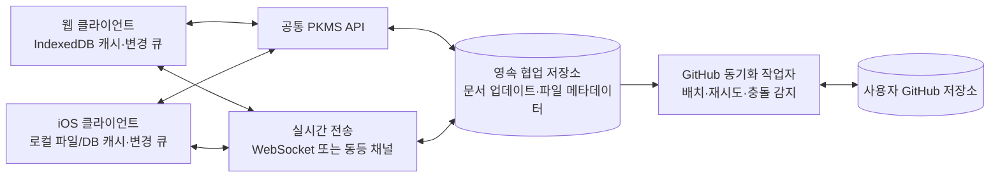

# PKMS Cloud Protocol 설계 초안

웹과 iOS 앱이 같은 GitHub 기반 PKMS를 사용하기 위한 제품·프로토콜 설계 초안입니다. 이 문서는 구현 전 합의된 방향과 검증이 필요한 설계안을 구분합니다.

## 목표와 결정 사항

### 목표

- Obsidian처럼 Markdown 파일과 일반 파일·폴더 경로를 기본 데이터 모델로 사용한다.
- 웹과 iOS 앱에서 같은 워크스페이스를 열고 동시에 편집할 수 있다.
- 온라인 편집은 즉시 화면에 반영되고, 다른 사용자의 변경도 실시간으로 보인다.
- 최근 열어본 파일을 기기에 캐시해 빠르게 열고, 오프라인 변경은 연결 복구 후 동기화한다.
- 서버는 협업 상태를 영속 저장하고 변경을 조정한다. GitHub는 파일의 버전 이력과 장기 저장소다.
- 협업 데이터는 서버에 즉시 보존하고, GitHub에는 변경을 모아 최대 15분 간격으로 커밋한다.
- 이진 파일의 동시 변경은 자동 병합하지 않고 충돌 사본으로 보존한다.

### 합의된 제품 방향

| 항목 | 방향 |
|---|---|
| 클라이언트 | 새 웹 클라이언트와 새 SwiftUI 앱을 공통 프로토콜로 구현한다. 기존 앱은 레거시로 취급한다. |
| 편집 경험 | Notion급 목표는 빠른 저장, 실시간 협업, 부드러운 동기화다. Notion의 페이지/블록 저장 구조를 복제하지 않는다. |
| 문서 형식 | Markdown 파일을 유지한다. 별도 블록 기반 페이지 저장소를 요구하지 않는다. |
| 파일 시스템 | 일반 컴퓨터의 파일/폴더처럼 경로로 탐색하고 관리한다. |
| 로컬 캐시 | 최근 열어본 Markdown 문서의 CRDT 상태를 자동 캐시하고 20개를 넘으면 오래된 항목부터 제거한다. |
| GitHub 반영 | 서버에 안전하게 저장한 뒤 변경을 배치 커밋한다. 목표 주기는 최대 15분이며, 조건부 조기 커밋 정책을 둔다. |
| 바이너리 충돌 | 서버는 경로 충돌을 충돌 사본 파일명으로 보존한다. 현재 파일명은 ` (conflict <client>)` 규칙을 사용한다. |
| 외부 Git 커밋 | MVP에서는 프로토콜 밖에서 이루어지는 직접 push를 정상 협업 경로로 지원하지 않는다. 감지 시 덮어쓰지 않고 동기화를 보류한다. |

## 시스템 구조



GitHub는 실시간 협업 서버가 아니다. 모든 활성 편집과 presence는 PKMS 서비스에서 처리한다. 서버 저장소는 프로세스 메모리가 아니라 재시작·배포 후에도 복구할 수 있는 영속 저장소여야 한다. GitHub 커밋 지연 중에도 사용자의 편집 내용이 보존되어야 한다.

## 공통 프로토콜 모델

### 식별자와 파일 경로

- `workspaceId`: PKMS에서 선택한 GitHub 저장소와 브랜치의 안정적인 식별자.
- `fileId`: 경로 변경 후에도 편집 세션을 식별하기 위한 PKMS 파일 식별자.
- `path`: 저장소 루트 기준 상대 경로. 구분자는 `/`이며 절대 경로, `..`, 빈 구성요소는 허용하지 않는다.
- Git 경로의 대소문자 구분을 기준으로 한다. 대소문자만 다른 경로를 표현할 수 없는 클라이언트에서는 충돌을 감지해 사용자에게 알려야 한다.
- 폴더는 경로 계층으로 표현한다. 빈 폴더 보존이 필요하면 Git에서 추적 가능한 명시적 메타데이터 규칙이 별도로 필요하다.

### 협업 상태와 revision

- 서버는 워크스페이스 내 변경을 단조 증가하는 `workspaceRevision`으로 기록한다.
- 텍스트 파일은 파일 단위 CRDT 문서로 공동 편집한다. 클라이언트는 CRDT 업데이트를 서버에 보내고, 누락된 업데이트를 받아 로컬 문서에 적용한다.
- presence(사용자, 열린 파일, 커서/선택 영역)는 일시 상태다. 영속 문서 기록이나 GitHub 커밋에 포함하지 않는다.
- 파일·폴더 만들기, 이름 변경, 이동, 삭제는 명시적 구조 작업으로 전송한다. 서버는 동일 경로에 대한 구조 작업을 직렬화하고 결과 revision을 부여한다.
- 업로드/삭제 등 되돌릴 수 있는 변경은 즉시 적용하되, GitHub 기록에 들어가기 전 상태를 사용자에게 구분해 보여준다.

Markdown 문서는 Yjs/Yrs v1 CRDT를 사용한다. 웹은 Yjs, iOS는 Rust의 Yrs core를 사용하며 같은 문서 루트(`markdown`), UTF-16 오프셋 규칙, v1 업데이트 인코딩을 공유한다. CRDT 포맷은 저장 데이터의 장기 호환성에 영향을 주므로 변경 시 프로토콜 버전과 마이그레이션 경로를 함께 정의한다.

### 상태 모델

```text
clean → locally-edited → server-accepted → github-synced
                 ↘ retrying / offline-queued
                 ↘ conflict-copy-created
```

- `locally-edited`: 입력이 즉시 화면에 반영되고 기기의 영속 변경 큐에도 기록된 상태.
- `server-accepted`: 백엔드가 변경을 영속 저장했고, 같은 워크스페이스의 다른 세션에 전파할 수 있는 상태.
- `github-synced`: 해당 변경이 포함된 GitHub 커밋과 브랜치 갱신을 확인한 상태.
- 재시도는 중복 적용되지 않아야 한다. 각 변경에는 클라이언트가 만든 고유 `operationId`를 포함한다.
- UI는 최소한 서버 저장과 GitHub 저장을 구분한다. 네트워크가 끊기면 변경이 기기에 대기 중임을 표시한다.

## API 초안

경로와 전송 형식은 제안이며, 프로토콜 버전 1을 구현하기 전에 OpenAPI 또는 동등한 기계 판독 명세로 고정한다. 일반 요청은 HTTPS/JSON, 실시간 협업 업데이트와 presence는 인증된 WebSocket을 우선 후보로 한다.

| 작업 | 제안 엔드포인트/채널 | 목적 |
|---|---|---|
| 로그인 완료 | `POST /v1/auth/github/callback` | GitHub OAuth 결과를 서버 세션으로 교환 |
| 워크스페이스 목록 | `GET /v1/workspaces` | 사용자가 연결한 저장소/브랜치 조회 |
| 초기 상태 읽기 | `GET /v1/workspaces/{id}/snapshot` | 파일 트리, revision, 필요한 메타데이터 로드 |
| 변경분 읽기 | `GET /v1/workspaces/{id}/changes?after={revision}` | 재연결·알림 누락 후 변경 복구 |
| 구조 작업 | `POST /v1/workspaces/{id}/operations` | 파일/폴더 생성·이동·이름 변경·삭제 |
| 파일 내용 읽기 | `GET /v1/workspaces/{id}/files/{fileId}` | 캐시 미스 또는 전체 내용 재동기화 |
| 실시간 연결 | `WS /v1/workspaces/{id}/stream` | CRDT 업데이트, revision 알림, presence 교환 |
| 바이너리 업로드 | 세션 발급 + 업로드 URL 또는 스트리밍 업로드 | 크기 제한·재시도·체크섬을 고려한 파일 전송 |
| 동기화 상태 | `GET /v1/workspaces/{id}/sync-status` | 최신 서버 revision, GitHub 동기화 시점, 오류 조회 |

구조 작업 요청에는 `operationId`, `baseRevision`, 작업 종류와 경로를 포함한다. CRDT 업데이트에는 `operationId`, `fileId`, 문서 포맷 버전, CRDT 업데이트 바이트를 포함한다. 서버는 요청을 영속화한 뒤 수락 revision을 반환한다. 요청 응답이 유실되어 재전송되더라도 같은 `operationId`는 한 번만 반영한다.

## 오프라인과 캐시 규칙

- 최근 열어본 Markdown 문서 최대 20개의 CRDT 상태를 로컬 영속 캐시에 둬 즉시 다시 열 수 있게 한다.
- 편집 중인 파일과 아직 서버가 수락하지 않은 변경은 캐시 정리 대상에서 제외한다.
- 오프라인 중 텍스트 편집은 로컬 CRDT 업데이트 큐에 저장한다. 재연결 후 서버와 양방향 교환해 병합한다.
- 오프라인 중 파일/폴더 작업은 operation queue에 보관한다. 경로가 이미 사용되었거나 부모가 삭제된 경우 서버 응답에 따라 재적용 또는 충돌 사본으로 해결한다.
- 캐시의 정확한 최대 파일 수/용량/보유 기간, 앱 삭제·로그아웃 시 삭제 정책은 별도 제품 결정이다.
- 앱과 웹은 캐시 구현이 달라도 위 상태와 복구 결과는 동일해야 한다.

## 충돌 규칙

### 텍스트

같은 파일을 프로토콜을 사용하는 여러 클라이언트가 동시에 편집하면 CRDT 업데이트를 합쳐 모든 온라인 참여자가 수렴하도록 한다. 텍스트 편집에서 파일 전체를 마지막 작성자 기준으로 덮어쓰지 않는다.

### 파일 시스템 작업

- 서로 다른 경로에 대한 독립 작업은 모두 적용한다.
- 같은 경로에 동시 생성/이동이 일어나면 한 작업은 원래 경로를 얻고 나머지는 충돌 사본 경로를 받는다.
- 삭제와 오프라인 수정이 겹치면 수정 내용을 보존하는 충돌 사본을 만들고 삭제 작업도 기록한다.
- 디렉터리 이동은 하위 경로 전체에 적용되는 원자 작업으로 취급한다. 부분 이동은 허용하지 않는다.

### 바이너리 파일

- 이미지 등 바이너리 동시 수정은 병합하지 않는다.
- 양쪽 내용을 모두 보존하고, 한쪽은 `name (conflict <client>).ext` 형태의 충돌 사본 경로에 둔다. 첫 적용 변경은 원래 경로를 유지한다.
- 체크섬과 파일 크기를 저장해 재전송 중 중복 업로드와 손상을 검출한다.

### GitHub 직접 변경

MVP는 PKMS API를 통하지 않은 GitHub 변경을 정상 입력 경로로 지원하지 않는다. 백그라운드 작업자가 예상한 브랜치 head와 실제 head가 다르면 해당 워크스페이스 커밋을 보류하고, 새 커밋을 덮어쓰지 않는다. 사용자에게 외부 변경 감지와 복구 동작을 표시한다. 외부 변경을 읽어 협업 문서 상태로 역수입하는 기능은 후속 범위다.

## GitHub 배치 동기화

- 서버는 각 워크스페이스의 GitHub 기준 head와 미커밋 변경을 영속 추적한다.
- 협업 변경은 즉시 서버 저장하지만 GitHub 커밋은 최대 15분 주기로 묶는다.
- 미커밋 변경량, 바이너리 크기, 운영상 재시도 한도 등 기준을 넘으면 15분 전에 커밋한다. 임계값은 부하 시험 후 정한다.
- 사용자가 수동 저장/내보내기를 요청한 경우와 앱에서 로그아웃·저장소 연결 해제를 요청한 경우에는 가능한 즉시 flush한다. 클라이언트 종료만으로 서버 작업이 사라져서는 안 된다.
- 커밋은 임시 Git tree와 commit을 만든 뒤 예상한 parent head일 때만 브랜치를 갱신한다. head가 달라졌으면 자동 force push하지 않는다.
- GitHub API 실패는 지수 백오프로 재시도하고, 성공 여부를 클라이언트에 노출한다. 제한에 도달하면 GitHub가 지정한 대기 시각을 따른다.
- 서버가 협업 데이터를 보유하는 기간과 GitHub 재시도/복구 운영 절차를 정한다. GitHub가 장기 저장소라는 이유만으로 아직 커밋되지 않은 변경을 제거하면 안 된다.

## 현재 구현 구성

- React Router 웹 앱과 API는 단일 Cloudflare Worker에서 제공한다.
- 계정과 워크스페이스마다 SQLite-backed Durable Object를 사용한다. 워크스페이스 Durable Object가 파일 메타데이터, 문서 상태, 멱등성 로그, WebSocket fan-out, GitHub flush alarm을 맡는다.
- 첨부파일 blob은 필요할 때만 R2에 둔다. 현재 업로드 상한은 50 MiB이고 Markdown 문서는 512 KiB로 제한한다.
- GitHub 커밋은 변경이 생긴 시점부터 15분 안에 배치한다. 변경 파일 100개 또는 5 MiB를 넘으면 더 일찍 flush한다.
- 직접 GitHub push 감지 시 자동 push를 멈추고 변경을 보존한다. 자동으로 외부 Git 커밋을 협업 상태로 가져오는 기능은 후속 작업이다.
- SwiftUI 앱은 Rust FFI로 같은 Yrs core를 사용하고 Keychain 세션, 최근 20개 문서 CRDT 캐시, 파일 업로드 및 Quick Look 첨부 미리보기를 제공한다.

## 인증·권한·보안

- 웹과 앱은 동일한 계정 및 워크스페이스 권한 모델을 사용한다.
- GitHub OAuth/GitHub App 토큰은 서버에서 관리하며 클라이언트 저장소나 로그에 토큰을 기록하지 않는다.
- 워크스페이스 접근은 세션 사용자와 연결된 GitHub 저장소 권한으로 확인한다. 클라이언트가 보낸 `workspaceId`만 믿고 접근을 허용하지 않는다.
- 웹훅을 도입할 경우 서명을 검증하고 중복·지연 이벤트를 안전하게 처리한다. 웹훅은 보조 알림이며 브랜치 head 확인이 최종 기준이다.
- 전송 중 TLS, 저장 데이터 암호화, 세션 만료/폐기, 감사 로그, 계정 연결 해제 시 토큰 폐기를 정책화한다.

## 제한과 운영 고려사항

- GitHub 일반 Git 파일은 100 MiB를 초과할 수 없다. 큰 파일은 MVP에서 상한을 정하거나 별도 객체 저장소를 검토한다. [GitHub large files](https://docs.github.com/en/repositories/working-with-files/managing-large-files/about-large-files-on-github)
- GitHub REST API 요청 한도와 저장소별 권장 push/read 빈도를 고려해 변경을 묶는다. [GitHub API rate limits](https://docs.github.com/en/rest/using-the-rest-api/rate-limits-for-the-rest-api), [repository limits](https://docs.github.com/en/repositories/creating-and-managing-repositories/repository-limits)
- GitHub recursive tree 조회는 100,000 항목 또는 7 MB 제한에 걸릴 수 있으므로, 트리 분할 조회나 지원 저장소 상한을 결정한다. [Git Trees API](https://docs.github.com/en/rest/git/trees)
- Vercel Functions 요청/응답 본문 한도는 4.5 MB이므로, 큰 바이너리를 함수 본문으로 중계하지 않는다. 직접 업로드/다운로드 URL 또는 별도 저장소가 필요하다. [Vercel Functions limits](https://vercel.com/docs/functions/limitations)
- 서버리스 함수의 인메모리 버퍼에 변경을 맡기지 않는다. 영속 DB/큐와 백그라운드 동기화 작업자가 필요하다.
- 실시간 협업은 네트워크 지연과 백엔드 장애 영향을 받는다. 클라이언트의 로컬 저장, 재연결, 미수락 변경 표시가 UX의 일부다.

## 기술 검증 계획

1. Markdown 편집기에서 타이핑, 선택, undo/redo, 붙여넣기, 대량 편집을 CRDT 업데이트로 변환한다.
2. 웹과 SwiftUI에서 같은 문서를 동시에 편집하고 커서/선택 상태를 표시한다.
3. 네트워크 차단 후 양쪽에서 편집하고 재연결해 텍스트가 손실 없이 수렴하는지 검증한다.
4. 최근 파일 캐시, 앱 재시작, 오프라인 operation queue 복구를 검증한다.
5. 파일 rename/delete와 이진 파일 동시 수정의 충돌 사본 경로·복구 흐름을 검증한다.
6. GitHub head 경합, API 실패/제한, 작업자 재시작 중에도 배치 변경이 유실·중복되지 않는지 검증한다.
7. Yjs/Yrs 계열 CRDT 후보의 Swift 바인딩, 웹 호환성, 라이선스, 문서 마이그레이션 가능성을 비교한다. Yjs는 오프라인 지원과 공유 데이터 타입을 제공하지만, Swift 바인딩의 성숙도는 별도 확인이 필요하다. [Yjs](https://docs.yjs.dev/), [YSwift](https://github.com/y-crdt/yswift)

## 후속 결정 항목

다음 항목은 첫 구현 범위를 확장할 때 정하면 된다.

1. **편집기 동작의 구체 범위:** Markdown 서식(제목, 목록, 체크박스, 표, 코드, 링크, 이미지), 키보드 단축키, undo/redo, 커서 presence 중 1차 버전의 필수 항목.
2. **워크스페이스 매핑:** GitHub 저장소 하나를 기본 워크스페이스로 볼지, 동일 저장소의 여러 브랜치를 별도 워크스페이스로 둘지.
3. **협업 권한:** 저장소 write 권한이 있는 사용자는 모두 편집자로 볼지, PKMS 내부 역할을 추가할지.
4. **프로토콜/문서 버전:** 향후 CRDT 업데이트 및 파일 메타데이터 스키마 변경의 호환·마이그레이션 정책.

## 용어

| 용어 | 의미 |
|---|---|
| workspace | GitHub 저장소와 브랜치에 연결된 PKMS 작업 공간 |
| operation | 파일 시스템 구조 변경을 나타내는 멱등성 있는 명령 |
| CRDT update | 공동 편집 텍스트의 병합 가능한 증분 변경 |
| workspaceRevision | 워크스페이스 변경 로그의 단조 증가 위치 |
| presence | 사용자 온라인 상태, 열린 파일, 커서/선택 위치 같은 비영속 협업 상태 |
| conflict copy | 병합할 수 없는 변경을 보존하기 위해 생성하는 별도 파일 |
